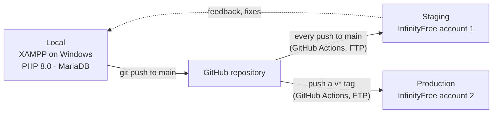
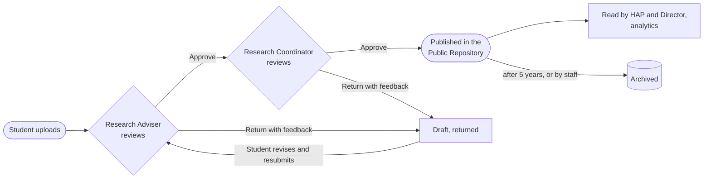
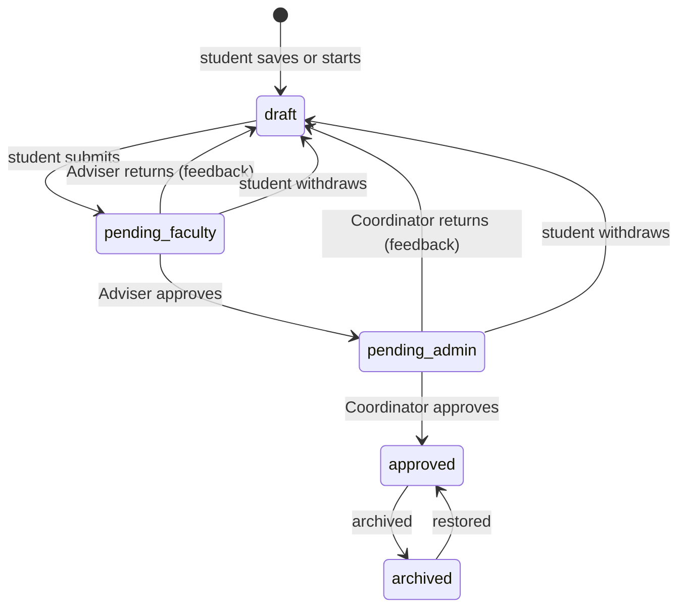
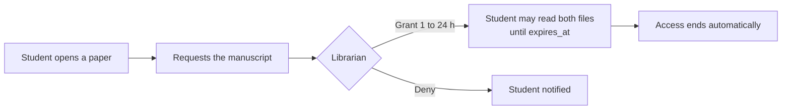
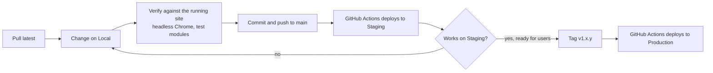
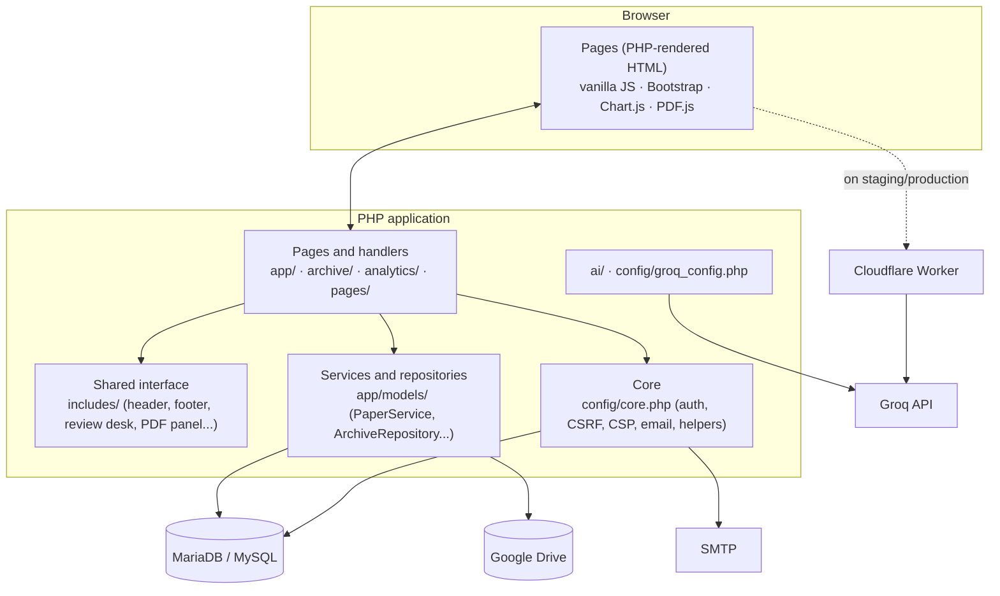
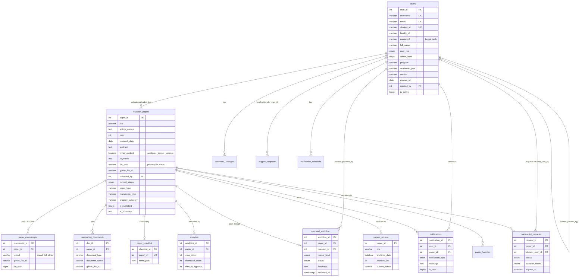

# PAPEL: System Overview, Version History and Database Design

**PUP Biñan Research Archiving System**
Reference material for Chapter 2 and Chapter 3 of the Capstone Project 2 paper.
Prepared 28 October 2026 from the repository (61 commits, 16 August to 27 October 2026), the
database structure in `database/schema.sql`, and the deployment workflows in `.github/workflows/`.

> **About the version numbers.** The repository has no version tags yet. The numbers in
> Section 3 were assigned after the fact, by reading the commit history and grouping it into
> releases under Semantic Versioning rules. They are a faithful reading of what changed and
> when, and they are the numbers we propose to adopt from here on. Section 3.5 explains how to
> start tagging without accidentally deploying an old build to production.

---

## Contents

1. [The system in one page](#1-the-system-in-one-page)
2. [Technical background (for Chapter 2)](#2-technical-background-for-chapter-2)
3. [Version history under Semantic Versioning](#3-version-history-under-semantic-versioning)
4. [Environments: Local, Staging and Production](#4-environments-local-staging-and-production)
5. [Users and their roles](#5-users-and-their-roles)
6. [System features by module](#6-system-features-by-module)
7. [Workflows](#7-workflows)
8. [System architecture](#8-system-architecture)
9. [Database design](#9-database-design)
10. [Security design](#10-security-design)
11. [Testing and verification](#11-testing-and-verification)
12. [Known limitations and the road to 1.0.0](#12-known-limitations-and-the-road-to-100)
13. [Where each part of this document fits in the paper](#13-where-each-part-of-this-document-fits-in-the-paper)

---

## 1. The system in one page

**PAPEL** is a web-based research archiving system for the Polytechnic University of the
Philippines, Biñan Campus. It replaces the hand-carried, paper-based routing of student research
with one online process:

1. A **student** uploads a paper (the manuscript PDF, the metadata, the written sections and the
   supporting documents).
2. The student's **Research Adviser** (faculty) reviews it against a checklist and approves it or
   returns it with feedback.
3. The **Research Coordinator** gives the final approval, which publishes the paper.
4. The **Public Repository** makes approved papers searchable and readable by students, staff
   and invited guests.

The **Head of Academic Programs** and the **Campus Director** read and monitor what comes out of
the chain, with analytics, but do not approve. The **Librarian** manages guest access and grants
students temporary access to full manuscripts.

| | |
|---|---|
| **Type** | Web application, server-rendered, no build step |
| **Stack** | PHP 8 · MariaDB / MySQL · Apache (XAMPP) · vanilla JavaScript · Bootstrap 5 · Chart.js · PDF.js |
| **File storage** | Google Drive (Drive API v3, one institutional account) |
| **AI** | Groq API (model `openai/gpt-oss-120b`) for metadata extraction, analytics insight and the help chatbot |
| **Email** | PHPMailer over SMTP |
| **Hosting** | Local: XAMPP on Windows. Staging and Production: InfinityFree, deployed by GitHub Actions over FTP |
| **Size** | about 20 database tables, 30 shared interface includes, 30 migration scripts, 15 automated test modules |

---

## 2. Technical background (for Chapter 2)

This section names each technology the system relies on and why it was chosen. It is written so
that it can be adapted into the Technical Background or Related Technologies part of Chapter 2.

### 2.1 Platform

| Technology | Version | Role in PAPEL | Why it was chosen |
|---|---|---|---|
| **PHP** | 8.0.30 locally; 8.2 at build; 8.4 on the host | All server logic, page rendering, the review chain, file handling | Runs on free shared hosting, which the campus can sustain at no cost; no framework needed for a system of this size |
| **MariaDB / MySQL** | MariaDB 10.4 (XAMPP) | Relational storage of users, papers, reviews, notifications, requests | Bundled with XAMPP and offered by every shared host; supports FULLTEXT search |
| **Apache HTTP Server** | XAMPP 8.0 | Web server, `.htaccess` rules | Standard on the hosting tier used |
| **Composer** | 2.x | Dependency manager (Google API client, PDF parser) | Dependencies installed and trimmed in CI, since the host has no shell |
| **Vanilla JavaScript** | ES2020 | Every interactive behaviour (upload form, panes, PDF panel, chat) | No build step; files are served as they are |
| **Bootstrap** | 5.3.2 | Grid, modals, dropdowns | Familiar to the team; restyled by the site's own design tokens |
| **Chart.js** | 4.4.0 | Analytics charts | Light, canvas-based; colours read from the theme at draw time |
| **PDF.js** | Mozilla | The in-site PDF viewer and the docked PDF panel | Lets a manuscript be read without downloading it, and with the site's own controls |

### 2.2 External services

| Service | Use |
|---|---|
| **Google Drive API v3** (`google/apiclient` 2.15) | Every manuscript and supporting document is stored in one institutional Drive folder. The database holds only the Drive file ID. |
| **Groq API** (OpenAI-compatible chat completions) | Extract title, authors, year and keywords from an uploaded PDF; write a plain-language insight on the analytics page; answer questions in the help chatbot. Two model "engines" are offered, named *Aincrad* and *Alfheim*. |
| **Cloudflare Workers** (`workers/groq-proxy`) | A small proxy holding the Groq key, because the free host cannot make outbound API calls. It accepts only a paper's text and asks only the one extraction prompt, so it cannot be used as a free general-purpose model. |
| **Google reCAPTCHA** | A robot check in front of both sign-in forms. Inert until its keys are configured. |
| **SMTP via PHPMailer** | Account creation, review results, password resets, manuscript-request answers. Every message uses one letterhead template. |
| **GitHub + GitHub Actions** | Version control, pull requests, and automatic deployment to staging and production. |

### 2.3 Libraries bundled with the code

`smalot/pdfparser` (reads the text out of a PDF for AI extraction and the abstract finder),
PHPMailer, and the project's own writers for exporting reports: `includes/xlsx_writer.php`,
`docx_writer.php` and `pdf_writer.php` (analytics and account lists export to Excel, Word and
PDF without a third-party library).

### 2.4 Standards and practices followed

- **Semantic Versioning 2.0.0** for releases (Section 3).
- **IMRaD** (Introduction, Methods, Results and Discussion) as the default structure of a
  manuscript's written sections, with the Full Manuscript (chapters) and custom structures beside it.
- **OWASP-aligned controls**: CSRF tokens, Content Security Policy with nonces, prepared
  statements, output escaping, login throttling (Section 10). An OWASP ZAP scan was run and its
  findings remediated in June 2026.
- **Continuous deployment** from the main branch to a staging environment, and tag-based
  releases to production.
- **Accessibility**: keyboard navigation, focus rings, a light/dark theme with selectable
  palettes, an Accessibility tab for text size and contrast.

---

## 3. Version history under Semantic Versioning

### 3.1 The rule

Semantic Versioning writes a release as **MAJOR.MINOR.PATCH**:

- **MAJOR** goes up for a change that breaks what already works for users or for stored data.
- **MINOR** goes up for a new feature that keeps everything else working.
- **PATCH** goes up for a fix that adds no feature.

While a system is still being built and has not been accepted by its users, it stays at
**0.y.z**: anything may still change. **1.0.0** is the first build released to its real users,
which for PAPEL is the production deployment after User Acceptance Testing. Pre-releases are
written with a suffix, for example `1.0.0-rc.1` (release candidate 1).

### 3.2 Summary

| Version | Date | Environment | Headline |
|---|---|---|---|
| 0.1.0 | 16 Aug 2026 | Local | Baseline: the full submission, review and repository system on a clean history |
| 0.2.0 | 23–24 Aug 2026 | Local | Account consoles rebuilt; Librarian guest access; support requests; report exports; PUPPY assistant gets a face |
| 0.3.0 | 30 Aug 2026 | Local | Upload Paper rework; dark mode; site-wide loading bar; automated test suite; reCAPTCHA on sign-in |
| 0.4.0 | 7 Sep 2026 | Local | Manuscript requests to the Librarian; browse cards; keyboard navigation; actions inside notifications |
| 0.5.0 | 18–20 Sep 2026 | Local | UI/UX revision: splash screen, page sections, banner slideshow, formatted chatbot replies |
| 0.5.1 | 20 Sep 2026 | Local | Fixes: archive sign-in panel on phones, small UI fixes; ERD and use case diagrams added |
| 0.6.0 | 1 Oct 2026 | Local | One file-serving endpoint for every manuscript; Workflow Handbook; chatbot hardening (prompt guard, rate limits) |
| 0.6.1 | 12 Oct 2026 | Local | Banner photographs replaced |
| 0.7.0 | 14 Oct 2026 | **Staging opens** | CI/CD to InfinityFree; one-time-code sign-in step removed; notification repair; host checks |
| 0.7.1 | 15–16 Oct 2026 | Staging | Staging start-up fixes; chatbot fixes; mascot GIF fix; loading glitch fix |
| 0.8.0 | 16 Oct 2026 | Staging | One shared PDF viewer and docked PDF panel site-wide; Corpus chatbot typing indicator |
| 0.9.0 | 21–22 Oct 2026 | Staging | Two manuscript files per paper (IMRAD and Full); chosen written sections; Groq proxy Worker; upload diagnostics |
| 0.9.1 | 22–23 Oct 2026 | Staging | Fixes: first-try sign-in, readable host refusals, Drive storage-folder check, adviser desk on an older database |
| 0.10.0 | 23 Oct 2026 | Staging | Editable review checklist for the Research Adviser |
| 0.11.0 | 23 Oct 2026 | Staging | Sections of the author's own (Custom mode, presets for thesis and feasibility study) |
| 0.11.1 | 27 Oct 2026 | Staging | Fix: `manuscript_requests` table added for databases built from `schema.sql` |
| 0.12.0 | 27 Oct 2026 | Staging | "Other" paper and manuscript types; year-only dates; faithful abstract extraction; type-in dropdowns |
| 0.13.0 | in progress | Local | Two-pane upload editor with tabs; live Public Repository preview of the paper |
| 1.0.0-rc.1 | planned | Production (UAT) | First production build, for User Acceptance Testing |
| 1.0.0 | planned | Production | Accepted release, after UAT and the final defence |

### 3.3 Release notes

#### 0.1.0 (16 August 2026): Baseline · Local

The project was moved to a fresh Git history. The earlier repository carried an email password
and students' consent and copyright forms, which cannot be removed from a history by a later
commit, so the code was re-committed clean with secrets in an ignored `.env` file.

What the system already did at this point:

- Sign-in by role (student, faculty, admin, head academic, super admin, librarian, guest).
- Student upload of a paper with its PDF, metadata and IMRaD sections, with AI metadata extraction.
- The approval chain: Research Adviser, then Research Coordinator, with return-with-feedback.
- The Public Repository with search and filters, the paper page and the PDF viewer.
- Review desks for each staff role, account management consoles, the analytics dashboard.
- Notifications in the app and by email; Google Drive storage; archiving of papers.

Also: a complete `.env` template (27 settings), the contributor notes in `CLAUDE.md`, and a Git guide.

#### 0.2.0 (23 to 24 August 2026): Accounts and administration · Local

- **Added** the Librarian's guest-access console (`librarian_manage_guests.php`), replacing the old admin guest page.
- **Added** support requests: a user who cannot sign in asks the right staff member for a password reset or an account fix (`support_requests` table).
- **Added** a password generator on every create-account form, a one-time password reveal, and a password audit tab (`password_changes` table).
- **Added** exports to Excel, Word and PDF from the project's own writers.
- **Added** `database/schema.sql`, so a new copy of the site can be built from one import.
- **Added** faces for the PUPPY upload assistant that react to the conversation (waiting, thinking, answered, failed), one colour per AI engine.
- **Removed** the forgotten-password and one-time-code pages, the separate HAP dashboards and stored plain-text passwords; the two HAP roles were routed to one desk.

#### 0.3.0 (30 August 2026): Upload Paper and the test suite · Local

- **Changed** the Upload Paper page and refined dark mode across the site.
- **Added** the one loading indicator for the whole site (`loading_bar.php`).
- **Added** the automated test suite (`tests/m1` to `m9`: authentication, dashboard, submission, review, archive, notifications, security, AI) with a results report.
- **Added** the Field Guide (`docs/field_guide.html`), a generated description of every page.
- **Added** a Google Drive keep-alive script so the stored token does not lapse.
- **Added** reCAPTCHA in front of both sign-in forms (the main one and the archive's). It stays switched off until both keys exist, so a missing key cannot lock everyone out.

#### 0.4.0 (7 September 2026): Manuscript requests · Local

- **Added** manuscript requests: a student asks a Librarian to unlock one paper's full manuscript, which is granted for 1 to 24 hours (`manuscript_requests` table, `app/librarian/manuscript_requests.php`).
- **Added** the shared browse card, keyboard navigation, and actions that can be taken straight from a notification.

#### 0.5.0 (18 to 20 September 2026): UI/UX revision · Local

- **Added** a splash screen, a favicon, page sections, and a re-styled set of management pages.
- **Changed** the Public Repository banner into a shuffled photo slideshow (every five seconds, a new order each visit).
- **Changed** chatbot replies to real paragraphs and lists.

**0.5.1 (20 September):** the archive sign-in panel no longer scrolls sideways on phones; small
UI fixes. The Entity Relationship Diagram and the Use Case Diagram were added to the
documentation with the scripts that draw them (`docs/diagrams/`); documentation does not change
the version of the software, so this stays a patch.

#### 0.6.0 (1 October 2026): One way to serve a file · Local

- **Added** `app/paper_file.php`, the single endpoint every manuscript and supporting document is served through, with its access checks in one place.
- **Added** the PAPEL Workflow Handbook (HTML and PDF, `docs/handbook/`).
- **Changed** the AI chatbot with a prompt-injection guard and per-user rate limits.

**0.6.1 (12 October):** banner photographs replaced.

#### 0.7.0 (14 October 2026): Staging opens

- **Added** GitHub Actions workflows: every push to `main` deploys to **staging**; a version tag deploys to **production**. The build installs and trims the Composer dependencies (about 900 files instead of 26,000, under the free host's file limit) and refuses any file over 10 MB.
- **Removed** the emailed one-time code from sign-in for good (`users.is_otp_exempt` dropped). Sign-in is ID and password.
- **Fixed** notifications stored with no type (`run_notification_type_repair.php`).
- **Added** host check utilities for the shared host.

#### 0.7.1 (15 to 16 October 2026): Staging fixes

Start-up and configuration fixes for the host, a mascot GIF upload fix, chatbot fixes, and a
loading glitch fix.

#### 0.8.0 (16 October 2026): One PDF viewer

- **Changed** the upload page to use the same PDF panel as every paper page, instead of a look-alike copy. A student's own file is drawn from memory and never leaves the browser until they submit.
- **Added** docking the PDF panel to either side of the page, between the navigation bar and the footer.
- **Added** a typing indicator for the Corpus chatbot (the PUPPY assistant's successor).

#### 0.9.0 (21 to 22 October 2026): Two manuscripts and chosen sections

- **Added** IMRAD and Full Manuscript as two files of one paper (`paper_manuscripts` table). A paper handed in both ways is one paper with two files, never two papers.
- **Changed** `supporting_documents.document_type` from an ENUM to a `VARCHAR` with a `document_name`, so a named optional document is no longer stored blank.
- **Added** the choice of which written sections to submit (the Abstract only, or any combination).
- **Added** the Groq proxy on Cloudflare Workers, since the host blocks outbound calls.
- **Added** `upload_diagnostics.php`, a staff page showing what the server can and cannot do, including database gaps.

#### 0.9.1 (22 to 23 October 2026): Fixes found on staging

- **Fixed** sign-in failing on the first attempt after an idle period (the sign-in form's security token was being discarded).
- **Fixed** refusals from the host reaching the student as an unexplained error.
- **Fixed** uploads failing because the configured Drive folder belonged to another account: the Storage Folder page now checks a folder before saving it.
- **Fixed** the Research Adviser's desk ending in an error on a database that had not run the latest migration; added `2026-10-21_catch_up.sql` for phpMyAdmin.

#### 0.10.0 (23 October 2026): Editable review checklist

- **Added** ready-made checklists (IMRaD, Undergraduate Thesis, Capstone Project, Feasibility Study, Blank) chosen from a dropdown, and editing sections for one paper (`paper_checklist.items_json`).
- **Changed** the checklist save to an upsert, so a second round of review keeps the new ticks.
- **Changed** the Coordinator's view of the checklist to read-only.

#### 0.11.0 (23 October 2026): Sections of the author's own

- **Added** Custom mode: authors add up to 12 sections with their own names, typed or from a preset (Full Manuscript, Undergraduate Thesis, Feasibility Study). Stored inside `imrad_content`, so no migration was needed.

#### 0.11.1 (27 October 2026): Database fix

- **Fixed** students meeting an error page on staging when opening a paper: the `manuscript_requests` table had never been exported into `schema.sql`. Added to it, plus `2026-10-27_manuscript_requests.sql`.

#### 0.12.0 (27 October 2026): Upload Paper updates

- **Added** "Other" for the paper type and the manuscript type, named in the student's own words.
- **Added** "No exact date: use the year only" for Date Completed.
- **Changed** abstract extraction to copy the abstract word for word from the PDF, or leave the box alone.
- **Added** type-to-search dropdowns for the paper type and the Academic Program.

#### 0.13.0 (in progress, not yet committed)

- **Added** the two-pane upload editor: tabs for Upload Paper, Writing View, Preview and the PDF on the main pane, and Contents and Corpus on a resizable, movable side pane.
- **Added** a live Preview of the paper exactly as the Public Repository will show it once published (`app/student/paper_preview.php`).

### 3.4 What has to happen before 1.0.0

See Section 12. In short: staging's database caught up, the production server set up by hand
(database, Drive connection, storage folder, `.env`), the remaining known gaps closed, and UAT
passed on a `1.0.0-rc` build.

### 3.5 Adopting the version numbers in Git

> ⚠ **Pushing any tag that starts with `v` deploys that build to production.** The production
> workflow runs on `tags: ['v*']`. Pushing `v0.1.0` today would replace production with the
> 16 August code.

To record the history safely, tag the past releases **without** the `v`, which the workflow
ignores, for example `git tag -a 0.12.0 d10fc1e -m "Upload Paper updates"`. Use the `v` prefix
only for a build that is meant to go to production, starting with `v1.0.0-rc.1`.

| Version | Commit |
|---|---|
| 0.1.0 | `1561f9e` |
| 0.2.0 | `9983202` |
| 0.3.0 | `36c5966` |
| 0.4.0 | `266d114` |
| 0.5.0 | `7e4aa84` |
| 0.5.1 | `b8d6b53` |
| 0.6.0 | `b25e378` |
| 0.6.1 | `da4ec44` |
| 0.7.0 | `658bddd` |
| 0.7.1 | `725b49a` |
| 0.8.0 | `e50ff4a` |
| 0.9.0 | `2e61da6` |
| 0.9.1 | `f6417de` |
| 0.10.0 | `9df9b90` |
| 0.11.0 | `aab033d` |
| 0.11.1 | `2293c6a` |
| 0.12.0 | `d10fc1e` |

---

## 4. Environments: Local, Staging and Production



| | **Local (development)** | **Staging** | **Production (future)** |
|---|---|---|---|
| Purpose | Build and test every change | See the latest work on a real host; find host-only problems | The system the campus uses; UAT then live use |
| Host | XAMPP on the developers' Windows machines | InfinityFree free hosting (nginx/openresty in front of Apache) | InfinityFree, a separate account |
| PHP | 8.0.30 | 8.4 (8.2 used to build) | Same as staging |
| Database | MariaDB, `capstone_db`, created from a full export | MySQL, built from an export on 14 October, then caught up by SQL files | Built from `schema.sql`, empty, first Director made by `scripts/setup.php` |
| Updated by | Saving files | Every push to `main` | Only a pushed `v*` tag; a rollback re-runs the workflow on an older tag |
| Migrations | PHP scripts from the command line (`scripts/migrations/*.php`) | No shell: SQL files pasted in phpMyAdmin (`scripts/migrations/sql/`) | Same as staging |
| `APP_ENV` | development | staging | production |
| Error detail | Shown, with the cause | Shown, with the cause, so testers can report it | Hidden: a reference number only, the cause goes to the server log |
| Groq calls | Direct from PHP | Through the Cloudflare Worker (outbound calls blocked) | Through the Worker |
| Not deployed | | `.env`, the Drive token, `uploads/`, `docs/`, `tests/`, `scripts/`, `database/`, `backups/`, `*.md` | Same as staging |

**Set by hand on each new copy, never by a deploy:** the database, `.env`, the Google Drive
connection (`config/gdrive_token.json`, via Reconnect on the Storage Folder page), and the Drive
storage folder, which is different on each copy and must be one the connected account can edit.

---

## 5. Users and their roles

| Role (`users.user_role`) | Title | What they do | Home page |
|---|---|---|---|
| `student` | Student | Upload, save drafts, resubmit returned papers, track progress, browse the repository, request manuscripts | `app/student/student_dashboard.php` |
| `faculty` | Research Adviser | Review their advisees' papers with the checklist; approve or return; create student accounts | `app/faculty/faculty_review_dashboard.php` |
| `admin`, `admin_level = 1` | Research Coordinator | Final approval and publishing; manage faculty accounts; analytics; connect Google Drive | `app/admin/admin_review_dashboard.php` |
| `admin`, `admin_level = 2`, or `head_academic` | Head of Academic Programs | Read and monitor published work; analytics | `app/faculty/head_review_dashboard.php` |
| `super_admin` | Campus Director | Read and monitor; manage administrator accounts; set the Drive storage folder | `app/admin/super_admin_review_dashboard.php` |
| `librarian` | Librarian | Issue time-limited guest passes; grant students time-limited access to manuscripts | `app/librarian/librarian_manage_guests.php` |
| `guest` | Guest (visiting researcher) | Read the repository for 1 to 24 hours on a pass from the Librarian | `archive/` |
| (none) | Public visitor | Read the repository's paper cards and abstracts | `archive/` |

Who creates whom: the Director creates administrators; the Research Coordinator creates faculty
and librarians; a Research Adviser creates their own students; the Librarian creates guest passes.

---

## 6. System features by module

### 6.1 Authentication and accounts

- Sign-in with an ID and password. The ID can be the student number, the faculty/staff ID, the username or the email; staff, librarians and the Director use the faculty tab.
- Robot check (reCAPTCHA) on both sign-in forms.
- Login throttling: 5 failed attempts per account per machine, 20 per machine, then a 15-minute lock (`login_attempts`).
- Idle sessions end after 30 minutes.
- **Student account expiry** from the section: year 1 lasts 5 academic years, year 2 lasts 4, year 3 lasts 3, year 4 and Ladderized last 2, ending on 31 July. Moving a student up a year renews the account.
- Support requests from the sign-in page for a forgotten password or an account problem, routed to whoever created the account.
- Password generator, one-time reveal of a new password, password-change audit trail.

### 6.2 Paper submission (student)

A four-step form (`app/student/student_upload_ai.php`):

1. **Paper details.** Paper type (Capstone Project, Undergraduate Thesis, Feasibility Study or Other), manuscript type (IMRAD, Full Manuscript, both, or Other), title, authors, Academic Program, keywords, Date Completed or the year only.
2. **Manuscript and written sections.** The PDF(s); **Extract with AI** fills the metadata and copies the abstract; the student chooses which sections to submit (Abstract only, any of the six standard sections, or Custom sections of their own), and writes them in a rich-text editor with images and tables.
3. **Supporting documents.** Required for some paper types, optional for others; named extra documents allowed.
4. **Review and submit.** Everything goes to Google Drive and the database in one all-or-nothing transaction.

Also: drafts saved on the server and autosaved in the browser; a live preview of the published page;
the PDF panel beside the form; the Corpus chatbot for help while writing; browser Back and
Forward move between steps.

### 6.3 Review and approval

- One review desk shared by four roles (`includes/review_console.php`), configured per role.
- The paper's full record, its manuscript(s) in the PDF panel, and the supporting documents.
- The **review checklist** for the Research Adviser: ready-made lists or edited for one paper.
- **Approve** forwards to the next step or publishes; **Return** sends it back to the student as a draft with feedback, and deletes the returned files from Drive so fresh ones are attached.
- A chip on each card shows which written sections were submitted.
- The student can withdraw a paper still in review, with the Adviser or with the Coordinator.

### 6.4 Public Repository and archive

- Search (FULLTEXT on title, abstract and keywords), filters by program, type, year and status, sorting.
- The paper page: metadata, the written sections, AI research facts (methodology, sample size, statistical methods, variables, field), and the manuscript for those allowed to read it.
- Guest access by a Librarian's pass; manuscript requests by students.
- Archiving: a paper can be archived and restored by staff; approved papers older than five years are archived automatically by a scheduled script (`notifications/cron/auto_archive_papers.php`).

### 6.5 Notifications and email

- In-app notification centre and bell, with actions inside a notice.
- Every notice is also emailed, on one PUP letterhead template.
- Types: submission, approval, decline, reminder, comment, manuscript, security, support, account.
- Scheduled reminders at 10:00 and 15:30 for reviewers with papers waiting (`notification_schedule`).

### 6.6 Analytics

- Tiles: submissions, approved, in review, returned, this month, average time to approval.
- Charts by program, type, year and status (Chart.js), enlargeable, following the theme.
- An AI-written insight on the figures.
- Export to CSV, Excel, Word and PDF.
- Counts only work actually handed in (a returned paper counts; an unsent draft does not).

### 6.7 AI features

| Feature | Where | What it does |
|---|---|---|
| Extract with AI | Upload page | Reads the PDF's text and fills title, authors, year and keywords; copies the abstract word for word if it can find it |
| Research facts | Paper page | Methodology, sample size, statistical methods, variables, research field (`ai_*` columns) |
| Corpus (formerly PUPPY) | Upload page | Help chatbot with a mascot that reacts; two engines, Aincrad and Alfheim |
| Help assistant | Help pages | Answers questions about using PAPEL |
| Analytics insight | Analytics | A written reading of the charts |

Safeguards: a prompt-injection guard, per-user rate limits (`ai_rate_limits`), text cut safely
for multi-byte characters, and a fallback API key.

### 6.8 Administration and settings

- Management consoles for students, faculty and administrators, with a confirm-before-save showing each changed field.
- Storage Folder page (Director): checks a Drive folder is usable before saving it.
- Upload diagnostics (staff): what the server can do, and which database changes are missing.
- Settings: profile, password, theme (light/dark, palettes), accessibility.

---

## 7. Workflows

### 7.1 The approval chain



Approval **ends at the Research Coordinator**. The chain was deliberately shortened from four
approvers to two; the Head of Academic Programs and the Director monitor but do not approve.

### 7.2 Paper status (state diagram)



`draft` means either "never submitted" or "returned". The system tells them apart by whether an
`approval_workflow` row exists for the paper. `pending_admin_l1`, `pending_head_academic`,
`pending_super_admin` and `declined` remain in the column for papers filed under the older,
longer chain.

### 7.3 Submitting a paper (sequence)

```mermaid
sequenceDiagram
    actor St as Student
    participant B as Browser
    participant W as PAPEL (PHP)
    participant G as Google Drive
    participant DB as Database
    participant Ad as Research Adviser
    St->>B: Fill the four steps, attach PDF(s)
    B->>W: Submit (form + files, CSRF token)
    W->>G: Is the storage folder usable?
    W->>G: Upload each PDF and document
    W->>DB: BEGIN; paper, manuscripts, documents, workflow row; COMMIT
    alt anything fails
        W->>DB: ROLLBACK
        W->>G: Delete the files this request uploaded
        W-->>B: Error with reference (and cause off production)
    else filed
        W->>DB: Notification for the Adviser
        W-->>Ad: Email
        W-->>B: Success, paper is "On process"
    end
```

### 7.4 Reviewing a paper

1. The Adviser opens the paper from the desk or the notification.
2. Reads the manuscript in the PDF panel, ticks the checklist (or edits it for this paper).
3. **Approve**: checklist saved, `approval_workflow` row written, status to `pending_admin`, Coordinator notified.
4. **Return**: feedback required, status to `draft`, files removed from Drive, student notified by app and email.
5. The Coordinator repeats the review (checklist read-only). Approve sets `approved`, `is_published`, stamps `time_to_approval`, and notifies the student and the readers.

### 7.5 Manuscript request



### 7.6 Guest access

The Librarian enters a visitor's name and a duration (1 to 24 hours); PAPEL creates a temporary
username and password, shows it once, and stores the pass in `guest_sessions`. The guest signs
in on the archive's own sign-in page and can read the repository until the pass expires; expired
passes can be cleared from the console.

### 7.7 Development and release workflow



A change that adds a column or table ships with four things: the structure in `schema.sql`, a
re-runnable SQL file for phpMyAdmin, a gap check that shows on the diagnostics page, and code that
keeps working on a database that has not run it yet.

---

## 8. System architecture

### 8.1 Layers



### 8.2 Folder structure

| Folder | Contents |
|---|---|
| `app/` | Signed-in pages by role: `student/`, `faculty/`, `admin/`, `librarian/`, `auth/`; `models/` (services and repositories); `review_paper.php`, `paper_file.php` |
| `archive/` | The Public Repository, the paper page, guest sign-in, archive handler |
| `analytics/` | Analytics dashboard and paper analysis |
| `ai/` | Chatbot, AI extraction, prompt guard, rate limiter |
| `config/` | `core.php` (the shared core), database, Drive, Groq and mail configuration, error handler, workflow helpers |
| `includes/` | Every shared piece of interface (header, footer, review desk, PDF panel, dialogs, theme) |
| `notifications/` | Notification centre and scheduled scripts (`cron/`) |
| `pages/` | Public and general pages: about, help, privacy, terms, settings, error page, Drive callback |
| `assests/` | Images, scripts (`papel-pdf-view.js`), PDF.js |
| `database/` | `schema.sql`, older SQL migrations and seeds |
| `scripts/` | Setup, migrations (PHP and SQL), utilities (not deployed) |
| `workers/groq-proxy/` | The Cloudflare Worker |
| `tests/` | Automated test modules and unit probes (not deployed) |
| `docs/` | Plans, handbook, diagrams, field guide (not deployed) |

---

## 9. Database design

### 9.1 Overview

MariaDB, InnoDB, `utf8mb4`. **20 tables** in `database/schema.sql`. Relationships are kept by
the application rather than by foreign keys in most cases, so that rows such as a paper's
manuscripts and checklist survive archiving and restoring; only `analytics` and the legacy
`imrad_checklist` declare foreign keys.

| Group | Tables |
|---|---|
| People and access | `users`, `guest_sessions`, `login_attempts`, `password_changes`, `support_requests` |
| Papers | `research_papers`, `paper_manuscripts`, `supporting_documents`, `papers_archive` |
| Review | `approval_workflow`, `paper_checklist` |
| Reading and requests | `manuscript_requests`, `analytics`, `paper_favorites` |
| Messaging | `notifications`, `notification_schedule` |
| AI | `ai_rate_limits`, `ai_processing_log` |
| Settings | `system_settings`, `gdrive_settings`, `storage_usage` |
| Legacy | `imrad_checklist` |

### 9.2 Entity Relationship Diagram

The drawn ERD is `docs/diagrams/PAPEL_erd.svg` (generated by `gen_erd.php`). The diagram below is
the same structure, current as of version 0.12.0.



### 9.3 Data dictionary (main tables)

#### `users`

| Column | Type | Description |
|---|---|---|
| `user_id` | INT, PK, auto | Identifier |
| `username`, `email` | VARCHAR, unique | Sign-in identifiers |
| `student_id` | VARCHAR(50), unique | Student number (students) |
| `faculty_id` | VARCHAR(50) | Staff ID (faculty and staff) |
| `password` | VARCHAR(255) | Password hash (never plain text since 0.2.0) |
| `full_name`, `title` | VARCHAR | Name and honorific |
| `user_role` | ENUM | `super_admin`, `admin`, `head_academic`, `faculty`, `librarian`, `student`, `guest` |
| `admin_level` | TINYINT | 1 = Research Coordinator, 2 = Head of Academic Programs |
| `admin_type` | ENUM | `research_coordinator`, `librarian`, `hap`, `director` |
| `program` | VARCHAR | Full program name (short code derived, e.g. BSIT) |
| `academic_year`, `section` | VARCHAR | Cohort; decide the account's expiry |
| `expires_on` | DATE | Last day the account may sign in |
| `created_by` | INT | Who created the account |
| `is_active`, `last_login`, `created_at` | | Status and timestamps |
| `reset_token`, `reset_expires` | | Password reset |

#### `research_papers`

| Column | Type | Description |
|---|---|---|
| `paper_id` | INT, PK, auto | Identifier |
| `title`, `author_names`, `keywords` | VARCHAR/TEXT | Metadata (FULLTEXT index on title, abstract, keywords) |
| `year`, `research_date` | INT, DATE | Year completed; exact date, or NULL when only the year is known |
| `abstract` | TEXT | The Abstract (read by cards, search and AI) |
| `imrad_content` | LONGTEXT (JSON) | The other written sections; `_scope` (which were submitted) and `_custom` (author's own sections) |
| `file_path`, `gdrive_file_id`, `file_size` | | Mirror of the primary manuscript file |
| `uploaded_by` | INT | The student |
| `upload_date` | TIMESTAMP | When it was filed |
| `current_status` | ENUM | `draft`, `pending_faculty`, `pending_admin`, `approved`, `archived` (and legacy values) |
| `paper_type` | VARCHAR(50) | `capstone`, `undergrad_thesis`, `project` (Feasibility Study) or `other:<name>` |
| `manuscript_type` | VARCHAR(100) | `IMRAD`, `Full Manuscript`, both, or `Other: <name>` |
| `program_category` | VARCHAR | Academic Program |
| `publication_status`, `publication_location` | VARCHAR | Whether and where it was published elsewhere |
| `is_published` | TINYINT | Visible in the repository |
| `ai_summary`, `ai_methodology`, `ai_sample_size`, `ai_statistical_methods`, `ai_variables`, `ai_research_field`, `ai_analyzed_at` | | AI research facts |

#### `paper_manuscripts`

One row per manuscript file. `format` is `imrad`, `full` or `other`; unique on (`paper_id`,
`format`), so a paper has at most one of each. `research_papers.file_path` always mirrors the
primary file (the Full Manuscript when there are two).

#### `supporting_documents`

One row per supporting document: `document_type` (VARCHAR, e.g. `copyright_doc`, `other`),
`document_name` (the student's name for an extra document), and its Drive file ID.

#### `approval_workflow`

One row per review decision: `paper_id`, `reviewer_id`, `review_level` (`faculty`, `admin`,
legacy `head_academic`, `super_admin`), `status` (`pending`, `approved`, `declined`), `feedback`,
`submitted_at`, `reviewed_at`. Its existence is what marks a draft as "returned" rather than new.

#### `paper_checklist`

One row per paper (unique `paper_id`). `items_json` holds the list exactly as the Adviser left it:
`{"v":1,"template":"...","edited":true,"items":[{"label":"...","ok":true}]}`. The eleven
`imrad_*` and `full_*` columns are read only for rows written before 0.10.0.

#### `manuscript_requests`

`paper_id`, `student_user_id`, `status` (`pending`, `granted`, `denied`), `duration_hours`
(1 to 24), `granted_by`, `granted_at`, `expires_at`, `denied_by`, `denied_at`, `created_at`.

#### `notifications`

`user_id`, `paper_id`, `notification_type` (ENUM: `submission`, `approval`, `decline`,
`reminder`, `comment`, `manuscript`, `security`, `support`, `account`), `message`, `is_read`,
`created_at`.

#### Other tables

| Table | Purpose |
|---|---|
| `papers_archive` | A copy of an archived paper's row, with `archived_date`, `archived_by` and the status it held; restored from here |
| `analytics` | Per paper: views, downloads, citations, approval date, days to approval |
| `guest_sessions` | Guest passes: username, password hash, expiry |
| `login_attempts` | Throttle counters per account+machine and per machine, with lock time |
| `password_changes` | Who changed whose password, and when |
| `support_requests` | Password and account requests, the requester, the handler, the message |
| `notification_schedule` | Reviewers' reminder times (10:00, 15:30) |
| `ai_rate_limits` | One row per AI call, to cap calls per user per period |
| `system_settings` | Key/value settings: Drive token, storage folder ID, others |
| `gdrive_settings` | Older Drive settings store |
| `paper_favorites`, `storage_usage`, `ai_processing_log`, `imrad_checklist` | Legacy: created by earlier versions, no longer written by the application |

### 9.4 Design decisions worth explaining in Chapter 3

- **Files outside the database.** Only Drive file IDs are stored; the PDFs live in one institutional Google Drive folder. This keeps the database small and the files backed by Google's storage.
- **No foreign keys on paper children.** Manuscripts, documents and checklists stay put when a paper moves to `papers_archive` and back.
- **Section choice and custom sections inside `imrad_content`.** Stored as JSON keys (`_scope`, `_custom`) instead of new columns, so archiving copies them with no schema change and older servers need no migration.
- **VARCHAR "kind" columns checked in PHP, not ENUMs.** The server runs without strict SQL mode, where an ENUM silently stores an empty string for an unknown value. Two real faults came from that (notification types and document types), and both columns that changed were moved to this rule.
- **One primary-file mirror.** `research_papers.file_path` always describes the main manuscript, so pages written before two-file papers still work.
- **Schema history.** 13 SQL migrations in `database/migrations/` (the early schema), 30 PHP migrations in `scripts/migrations/`, and 3 phpMyAdmin catch-up files in `scripts/migrations/sql/` (21, 23 and 27 October 2026).

---

## 10. Security design

| Threat | Control |
|---|---|
| Cross-site request forgery | A token in every form (`csrf_field()`), checked on every POST (`csrf_verify()`) |
| Cross-site scripting | Output escaped with `e()`; Content Security Policy with a per-request nonce on every inline script and style; no inline style attributes allowed |
| SQL injection | Prepared statements everywhere; the one dynamic sort column is whitelisted |
| Brute-force sign-in | reCAPTCHA; throttling per account and per machine; 15-minute locks |
| Unauthorised pages | `require_role([...])` at the top of every page; a background call is answered in JSON |
| Unauthorised files | Every file served through `app/paper_file.php`, which checks the reader's role, the paper's status and any librarian grant |
| Leaked secrets | Keys and passwords only in `.env` (never committed, never deployed); the Groq key held by the Worker, not the page |
| Expired access | Student accounts expire by cohort; guest passes and manuscript grants expire by the hour; idle sessions end after 30 minutes |
| Error disclosure | Production shows a reference number only; detail goes to the server log |
| AI misuse | Prompt-injection guard, per-user rate limits, the Worker accepts no prompt of its own |
| Third-party scripts | Subresource Integrity hashes on CDN files (`config/sri_hashes.php`) |

---

## 11. Testing and verification

| Kind | How | Where |
|---|---|---|
| Module tests | Python scripts that drive the running site over HTTP | `tests/m1_auth.py` to `m15_other_types.py` |
| Unit probes | PHP scripts for the pure functions (abstract finder, checklist, section scope, failures) | `tests/_*_unit.php` |
| Browser behaviour and layout | Headless Chrome with a probe script; screenshots measured with `getBoundingClientRect()` | Scratch scripts |
| Real submissions | End-to-end submissions that upload to Google Drive, then remove the files and test accounts | `m10`, `m13`, `m15` |
| Failure paths | Drive set aside, a table renamed for one request, to see what the user is told | `m11_submit_failures.py` |
| Older database | A scratch copy at the 14 October shape, served by a second PHP server with PHP 8.1 error behaviour | `m13_old_schema.py` |
| Staging | Every push deployed and tried on the real host | GitHub Actions |
| Security scan | OWASP ZAP, findings remediated June 2026 | `docs/security_vulnerability_fixes.md` |

| Module | Covers |
|---|---|
| m1 | Authentication: sign-in, roles, lockouts |
| m3 | Dashboards |
| m4 | Submission |
| m5 | Review and approval |
| m6 | Archive and restore |
| m7 | Notifications and email |
| m8 | Security: CSRF, access control, headers |
| m9 | AI features |
| m10 | Choosing written sections; custom sections |
| m11 | What a failed submission tells the student |
| m12 | Drive storage-folder check |
| m13 | Running on a database behind the code |
| m14 | Review checklist |
| m15 | "Other" paper and manuscript types |

---

## 12. Known limitations and the road to 1.0.0

**Before `1.0.0-rc.1` (UAT on production):**

- [ ] Run the three SQL files on staging (`2026-10-21_catch_up.sql`, `2026-10-23_checklist_items.sql`, `2026-10-27_manuscript_requests.sql`) until the diagnostics page reads "No gaps".
- [ ] Commit and deploy 0.13.0 (two-pane editor and preview) and test it on staging.
- [ ] Replace the placeholder `CSRF_KEY` in `.env` (this signs everyone out once).
- [ ] Set up production by hand: import `schema.sql`, create the first Director with `scripts/setup.php`, write `.env` with `APP_ENV=production`, connect Google Drive, set a storage folder that account can edit, set the Worker's allowed origins.
- [ ] Recover or reset the Director's password on each copy.

**Before `1.0.0`:**

- [ ] UAT with each role: student, Adviser, Coordinator, HAP, Director, Librarian, guest.
- [ ] Fix what UAT finds (each fix a `1.0.0-rc.N`).
- [ ] Remove the leftover inline `style="..."` attributes (blocked by the CSP and so doing nothing).
- [ ] Retire or update the stale files in `docs/`.

**Accepted limitations:**

- `time_to_approval` exists only for papers approved after it was added.
- Drafts hold no PDF: a student re-attaches the files when continuing a draft (deliberate, so nothing is stored for work not handed in).
- Free hosting limits: no shell, no outbound API calls, 10 MB per file, about 30,000 files per account.

---

## 13. Where each part of this document fits in the paper

The exact chapter titles depend on the college's Capstone Project 2 template; this is the usual
mapping.

| Paper section | Use |
|---|---|
| **Chapter 2**: Technical background, related technologies, conceptual framework | Section 2 (technologies and services, with the reasons), Section 1 (scope), Section 5 (users) |
| **Chapter 3**: Methodology, software development model | Section 3 (iterative releases under Semantic Versioning), Section 4 (environments), Section 7.7 (development and release workflow) |
| **Chapter 3**: System design | Section 6 (features by module), Section 7 (workflows, state and sequence diagrams), Section 8 (architecture) |
| **Chapter 3**: Database design | Section 9 (ERD, data dictionary, design decisions); `docs/diagrams/PAPEL_erd.svg` |
| **Chapter 3**: Use cases | Section 5 and `docs/diagrams/PAPEL_use_case_diagram.svg` |
| **Chapter 3**: Security and testing | Sections 10 and 11 |
| **Chapter 3 or 4**: Implementation plan | Sections 4 and 12 |

The Mermaid diagrams render on GitHub and in VS Code's Markdown preview; for the paper, export
them as images (for example at mermaid.live) or redraw them in the paper's diagram tool.
