# PAPEL: Class Diagram

**Kind:** current. Describes the code as it is written, not as it might be.
**Editable drawing:** [`papel_class.drawio.svg`](papel_class.drawio.svg)
**Generated:** 15 November 2026, from `app/models/`, `config/` and the page
handlers under `app/`.

---

## How to use this file

Hand the whole file to Claude Co-Work with one of these:

> Draw the PAPEL class diagram from the specification below. Keep the four
> stereotypes, every member and every relationship as listed. Output
> draw.io-editable SVG.

> Check `docs/diagrams/papel_class.drawio.svg` against the specification below
> and list every method that has been renamed, added or removed in the code
> since the drawing was made.

---

## 1. The honest shape of this system

PAPEL is **PHP 8.0 with no framework, no ORM and no build step**, and it is only
partly object oriented. A class diagram that invents a tidy class per table
would be a drawing of a different system. This one uses four kinds of box, and
the legend says which is which.

| Stereotype | What it is | Where |
|---|---|---|
| `<<page>>` | A request handler: one PHP file that is both controller and view | `app/**/*.php` |
| *(none)* | A real PHP class with real methods | `app/models/` |
| `<<module>>` | A file of functions standing where a class would | `config/core.php`, `config/gdrive_config.php` |
| `<<entity>>` | A conceptual class. **A row is an associative array here, not an object** | named by its table |

Two consequences worth stating on the drawing:

1. **The operations drawn on an entity are free functions** in `config/core.php`
   that take the array. `paper_primary_format($paper)` is not a method.
2. **Not every page goes through a service.** This is the state of the code:
   - `app/admin/admin_review_dashboard.php` goes through `PaperService`.
   - `app/faculty/faculty_review_dashboard.php` calls `add_workflow()` and
     `set_status()` itself and sets `pending_admin`.
   - `app/admin/admin_manage_faculty.php` uses `FacultyManagementService`, but
     `app/faculty/faculty_manage_students.php` writes its own `INSERT`.

`config/core.php` is about 5,000 lines, so the drawing splits it into the four
concerns it actually serves rather than drawing one box with 200 methods.

## 2. Boundary: the page handlers

| Class | File | Operations |
|---|---|---|
| StudentUploadPage | `app/student/student_upload_ai.php` | `handleSubmit()`, `handleSaveDraft()`, `handleExtractAi()`, `handleGetLocations()`, all answering JSON |
| FacultyReviewDashboard | `app/faculty/faculty_review_dashboard.php`, `require_role(['faculty'])` | `approve(paper_id, checklist)`, `decline(paper_id, feedback)` |
| AdminReviewDashboard | `app/admin/admin_review_dashboard.php`, `require_role(['admin'])` at level 1 | `approve(paper_id)` which publishes, `decline(paper_id, feedback)` |
| SuperAdminReviewDashboard | `app/admin/super_admin_review_dashboard.php`, `require_role(['super_admin'])` | `archive(paper_id)`, `restore(paper_id)` |
| ManagementConsole | `faculty_manage_students.php`, `admin_manage_faculty.php`, `super_admin_manage_admins.php` | `create()`, `update()`, `reset()`, `importSpreadsheet()` |
| LibrarianDesk | `app/librarian/manuscript_requests.php` | `grant(request_id, hours)`, `deny(request_id)`, `revoke(request_id)` |

These are drawn as one box each because they are one file each. The three
management consoles share one box because they share
`includes/manage_page.php`, `includes/manage_console.php` and
`includes/manage_import.php` and differ only in which accounts they may touch.

## 3. Application services (`app/models/`)

### PaperService

No constructor, no fields: it calls free functions.

```
+ approvePaper(paperId, reviewerId, reviewLevel, targetStatus, message) : void
+ declinePaper(paperId, reviewerId, reviewLevel, feedback, message) : void
+ archivePaper(paperId, userId) : bool
- recordTimeToApproval(paperId) : void
```

`approvePaper()` calls `add_workflow()`, then `set_status()`, then
`recordTimeToApproval()` **only when `targetStatus === 'approved'`**, then
`create_notification()` with type `'approval'` and a subject that depends on the
stage. `recordTimeToApproval()` swallows everything it catches: a paper being
approved matters, a statistic about it does not.

`declinePaper()` calls `add_workflow()`, `set_status($id, 'draft')`,
`purge_paper_drive_files($id)`, then notifies.

### ArchiveService

```
- conn : mysqli
- archiveRepo : ArchiveRepository
+ __construct(dbConnection)
+ archivePaper(paperId, archivedBy) : bool
+ restorePaper(paperId) : bool
```

### FacultyManagementService

```
- userRepo : UserRepository
- const MANAGES = ['faculty', 'librarian']
+ createFaculty(data, createdBy, notify = true)
+ updateFaculty(data, userId)
+ toggleFacultyStatus(userId)
+ deleteFaculty(userId)
+ resetFacultyPassword(userId, newPassword)
+ getActiveFaculty() : array
+ getInactiveFaculty() : array
- sendWelcomeEmail(userData)
```

`MANAGES` is a list and not a single role because the Research Coordinator's
console manages advisers and librarians together.

### AdminManagementService

```
- conn : mysqli
+ __construct(conn)
+ createAdmin(data, createdBy, notify = true)
+ updateAdmin(data, userId)
+ toggleStatus(userId)
+ deleteUser(userId)
+ resetPassword(userId, newPassword)
+ getAdminsByLevel(level)
+ getStaffByPosition(positions) : array
```

### UserFacingException

```
class UserFacingException extends Exception {}
```

Declared in `config/core.php`. The distinction it draws is the whole of the
upload page's error handling: a `UserFacingException` carries a message the
student may act on and is shown as it stands; **any other exception is a fault**
and becomes "Upload failed. Please try again." with a reference, plus the real
cause on any copy of the site that is not production.

## 4. Repositories (`app/models/`)

### PaperRepository

```
- conn : mysqli
+ getPapersByStatus(statuses, limit = null)
+ getDeclinedPapers(reviewLevel)
+ getSupportingDocs(paperId)
+ getTimelineData(approvedOnly = false)
+ getApprovalRateByType(superAdminFlow = false)
+ getMonthlyComparison(approvedOnly = false)
+ getReportsData()
```

### UserRepository

```
- conn : mysqli
+ createUser(data)
+ updateFacultyDetails(userId, data, password)
+ updatePassword(userId, role, hash)
+ toggleActiveStatus(userId, role)
+ deleteUser(userId, role)
+ isUsernameOrEmailExists(username, email)
+ isFacultyIdExists(facultyId)
+ isEmailOrFacultyIdTaken(email, facultyId, exceptUserId)
+ facultyIdOf(userId) : string
+ getUsersByRolesAndStatus(roles, isActive)
+ getUsersByRoleAndStatus(role, isActive)
- roleGuard(role) : array
- runGuarded(sql, head, headTypes, role) : bool
```

The `role` argument on the four guarded methods is **a guard, not a lookup**: it
stops one console acting on an account belonging to another. Draw it as a note.

`facultyIdOf()` matters more than it looks: it is how the server learns which
staff ID an account already carries, so that a legacy ID (`FC-00123`,
`HAP-00123`, `DIR-2026-001`) can be let through on edit. It must come from the
database and never from the form.

### ArchiveRepository

```
- conn : mysqli
- COLUMNS : one list, used by both inserts
+ getActivePaper(paperId)
+ getArchivedPaper(paperId)
+ insertToArchive(paper, archivedBy)
+ insertToActive(paper)
+ deleteActive(paperId)
+ deleteArchive(paperId)
```

The single column list is deliberate: building both statements from one list is
what stops archive and restore drifting apart. **Anything stored inside
`imrad_content` therefore survives archiving with no change at all**, which is
why `_scope`, `_custom` and `_docs` live there rather than in columns.

### mysqli `<<PHP extension>>`

```
+ prepare(sql) : mysqli_stmt
+ begin_transaction() / commit() / rollback()
```

One connection, handed out by `db()`. Note on the drawing: **PHP 8.1+ makes
mysqli throw on a failed query; 8.0, which this machine runs, stays silent and
returns false.** Staging runs 8.4, so a statement that fails quietly here can
end a request there.

## 5. Domain entities

Drawn `<<entity>>` with the table named. Attributes are the columns a reader
needs; the ERD has all of them.

| Entity | Table | Operations drawn on it (free functions) |
|---|---|---|
| User | `users` | `user_roles()`, `user_has_role()`, `user_level_for()`, `student_expiry_date()` |
| ResearchPaper | `research_papers` | `paper_declared_formats()`, `paper_primary_format()`, `paper_section_scope()`, `paper_custom_sections()`, `paper_date_display()` |
| PaperManuscript | `paper_manuscripts` | `paper_manuscript_entries()`, `paper_manuscript_rows()` |
| SupportingDocument | `supporting_documents` | `supporting_doc_label()`, `supporting_docs_extra()` |
| ApprovalWorkflow | `approval_workflow` | `add_workflow()`, `workflow_progress_steps()` |
| PaperChecklist | `paper_checklist` | `paper_checklist_load()`, `paper_checklist_clean()`, `paper_checklist_save()` |
| ManuscriptRequest | `manuscript_requests` | `manuscript_request_state()`, `manuscript_request_file()` |
| Notification | `notifications` | `create_notification()` |
| PaperFavorite | `paper_favorites` | `paper_save_set()`, `saved_paper_ids()` |
| ArchivedPaper | `papers_archive` | through `ArchiveRepository` only |

Associations between entities:

| From | To | Kind | Multiplicity |
|---|---|---|---|
| User | ResearchPaper | association, "uploads" | 1 to 0..n |
| ResearchPaper | PaperManuscript | **composition** | 1 to 1..n (1 or 2 in practice) |
| ResearchPaper | SupportingDocument | **composition** | 1 to 0..n |
| ResearchPaper | ApprovalWorkflow | association, "is reviewed in" | 1 to 1..n |
| User | ApprovalWorkflow | association, "decides" | 1 to 0..n |
| ResearchPaper | PaperChecklist | association | 1 to 0..1 |
| User | ManuscriptRequest | association, "asks for" | 1 to 0..n |
| ResearchPaper | ManuscriptRequest | association | 1 to 0..n |
| User | Notification | association, "is told" | 1 to 0..n |
| User | PaperFavorite | association, "saves" | 1 to 0..n |
| ResearchPaper | ArchivedPaper | dependency, "copied on archive, then deleted here" | 1 to 0..1 |

Composition is the right arrow for the manuscripts and the supporting
documents: they have no meaning without their paper, and submitting is
all-or-nothing in one transaction. It is **not** right for `ArchivedPaper`,
which deliberately outlives its paper.

## 6. The function modules

### `config/core.php`, split by concern

**Access control**
```
require_login() / require_role(roles)
password_gate()                       the first sign-in
user_roles(u) / user_has_role(u, role)
user_level_for(u, role) : int
is_research_coordinator(u) : bool
can_manage_research_operations(u) : bool
require_research_operations()
role_home(role) / role_home_label(role) / login_url()
csrf_field() / csrf_verify() / csrf_valid() / csp_nonce() / e()
```

**Paper and workflow** (with `config/workflow.php`)
```
paper_owner(id) / set_status(id, status)
add_workflow(id, reviewer, level, status, feedback)
workflow_progress_steps(status, hasFeedback)
workflow_status_badge_text() / workflow_status_category()
submission_cancel_state(paper, conn)
paper_manuscript_entries(paper) / paper_manuscript_rows(ids)
paper_sections_for_display(paper)
paper_is_readable(id) : bool
student_manuscript_access(userId, paperId) : bool
manuscript_request_file(u, paperId, paper, hasFile)
```

**Notification and mail**
```
create_notification(userId, paperId, type, message, subject = null)
send_email(to, subject, body) : bool
email_layout(subject, body) / email_para() / email_details() / email_action()
password_upline(userId) : ?int
account_change_notice(...)
```

**Account rules**
```
person_name_problem(name, live) : ?string
student_number_problem() / staff_id_problem() / account_email_problem()
section_problem() / academic_year_problem()
student_account_years(section) / student_expiry_date(section, ay)
password_change_apply(u, current, new, confirm)
profile_self_update(u, name, email) / profile_self_editable(u)
account_import_check_row(row, kind)       config/account_import.php
```

### `config/gdrive_config.php`
```
is_gdrive_connected() : bool
gdrive_check_folder(folderId) : array
gdrive_folder_is_unusable(check) : bool
upload_paper_to_gdrive(path, name, program, year, type, title, root, userId) : ?string
upload_supporting_doc_to_gdrive(...) : ?string
delete_from_gdrive(fileId) : bool
purge_paper_drive_files(paperId) : int
stream_from_gdrive(fileId) : array
```

### `config/groq_config.php` (not on the drawing, worth knowing)
```
groq_pool_request(...)      the only place the fallback logic lives
call_groq_api(...)          a wrapper over it
groq_key_chain(start)       orders the whole pool from a starting key
ai_engine_names() / ai_engine_current() / ai_engine_adopt()
pdf_text_clip(text, bytes)  cuts on a character boundary, never a byte
```

**`ai/groq_config.php` is a stale duplicate that nothing requires.** Do not draw
it and do not include it.

## 7. Mermaid source

Mermaid's class diagram has no stereotype of its own, so each one is written as
an annotation line.

```mermaid
classDiagram
    class StudentUploadPage {
        <<page>>
        +handleSubmit() json
        +handleSaveDraft() json
        +handleExtractAi() json
    }
    class FacultyReviewDashboard {
        <<page>>
        +approve(paperId, checklist)
        +decline(paperId, feedback)
    }
    class AdminReviewDashboard {
        <<page>>
        +approve(paperId) publishes
        +decline(paperId, feedback)
    }
    class SuperAdminReviewDashboard {
        <<page>>
        +archive(paperId)
        +restore(paperId)
    }
    class ManagementConsole {
        <<page>>
        +create()
        +update()
        +reset()
        +importSpreadsheet()
    }
    class LibrarianDesk {
        <<page>>
        +grant(requestId, hours)
        +deny(requestId)
        +revoke(requestId)
    }

    class PaperService {
        +approvePaper(paperId, reviewerId, reviewLevel, targetStatus, message) void
        +declinePaper(paperId, reviewerId, reviewLevel, feedback, message) void
        +archivePaper(paperId, userId) bool
        -recordTimeToApproval(paperId) void
    }
    class ArchiveService {
        -mysqli conn
        -ArchiveRepository archiveRepo
        +archivePaper(paperId, archivedBy) bool
        +restorePaper(paperId) bool
    }
    class FacultyManagementService {
        -UserRepository userRepo
        -MANAGES faculty_librarian
        +createFaculty(data, createdBy, notify) 
        +updateFaculty(data, userId)
        +toggleFacultyStatus(userId)
        +deleteFaculty(userId)
        +resetFacultyPassword(userId, newPassword)
        -sendWelcomeEmail(userData)
    }
    class AdminManagementService {
        -mysqli conn
        +createAdmin(data, createdBy, notify)
        +updateAdmin(data, userId)
        +toggleStatus(userId)
        +resetPassword(userId, newPassword)
        +getStaffByPosition(positions) array
    }
    class UserFacingException {
        <<Exception>>
        +getMessage() string
    }

    class PaperRepository {
        -mysqli conn
        +getPapersByStatus(statuses, limit)
        +getDeclinedPapers(reviewLevel)
        +getSupportingDocs(paperId)
        +getReportsData()
    }
    class UserRepository {
        -mysqli conn
        +createUser(data)
        +updateFacultyDetails(userId, data, password)
        +facultyIdOf(userId) string
        +getUsersByRolesAndStatus(roles, isActive)
        -roleGuard(role) array
        -runGuarded(sql, head, headTypes, role) bool
    }
    class ArchiveRepository {
        -mysqli conn
        -COLUMNS one_list_for_both_inserts
        +insertToArchive(paper, archivedBy)
        +insertToActive(paper)
        +deleteActive(paperId)
        +deleteArchive(paperId)
    }

    class User {
        <<entity>>
        +int user_id
        +string full_name
        +UserRole user_role
        +int admin_level
        +string secondary_position
        +int created_by
        +user_roles() UserRole
        +user_has_role(role) bool
    }
    class ResearchPaper {
        <<entity>>
        +int paper_id
        +string title
        +json imrad_content
        +PaperStatus current_status
        +string manuscript_type
        +paper_primary_format() Format
        +paper_section_scope() array
    }
    class PaperManuscript {
        <<entity>>
        +int manuscript_id
        +ManuscriptFormat format
        +string gdrive_file_id
    }
    class SupportingDocument {
        <<entity>>
        +int doc_id
        +string document_type
        +string document_name
    }
    class ApprovalWorkflow {
        <<entity>>
        +ReviewLevel review_level
        +string status
        +string feedback
    }
    class PaperChecklist {
        <<entity>>
        +json items_json
    }
    class ManuscriptRequest {
        <<entity>>
        +RequestStatus status
        +datetime expires_at
        +manuscript_request_state() string
    }
    class Notification {
        <<entity>>
        +NotificationType notification_type
        +string message
    }
    class ArchivedPaper {
        <<entity>>
        +int archived_by
        +datetime archived_date
    }

    AdminReviewDashboard ..> PaperService : uses
    SuperAdminReviewDashboard ..> ArchiveService : uses
    ManagementConsole ..> FacultyManagementService : uses
    ManagementConsole ..> AdminManagementService : uses
    PaperService ..> PaperRepository
    ArchiveService *-- ArchiveRepository : builds
    FacultyManagementService *-- UserRepository : builds

    User "1" --> "0..n" ResearchPaper : uploads
    ResearchPaper "1" *-- "1..n" PaperManuscript : has 1 or 2 files
    ResearchPaper "1" *-- "0..n" SupportingDocument : has
    ResearchPaper "1" --> "1..n" ApprovalWorkflow : is reviewed in
    User "1" --> "0..n" ApprovalWorkflow : decides
    ResearchPaper "1" --> "0..1" PaperChecklist
    User "1" --> "0..n" ManuscriptRequest : asks for
    ResearchPaper "1" --> "0..n" ManuscriptRequest
    User "1" --> "0..n" Notification : is told
    ResearchPaper ..> ArchivedPaper : copied on archive, then deleted here
```



## 8. Checking the drawing against the code

```bash
# every class and its methods
grep -rn "^class \|    public function \|    private function " app/models/*.php

# every page that is drawn as a boundary class, and who may open it
grep -rn "require_role(" app/admin app/faculty app/librarian app/student

# the four core.php concerns, to catch a function that has moved or gone
grep -n "^function " config/core.php | wc -l
```

A method on the drawing that no longer exists is the failure mode to watch for,
because this is the kind of document people trust without checking. If
`grep -n "function <name>" config/core.php` finds nothing, the drawing is wrong
and not the code.
