# PAPEL: Entity Relationship Diagram

**Kind:** current. Describes the database as `database/schema.sql` creates it.
**Editable drawing:** [`papel_erd.drawio.svg`](papel_erd.drawio.svg)
**Generated:** 15 November 2026, from `database/schema.sql` (22 tables).

---

## How to use this file

Hand the whole file to Claude Co-Work with one of these:

> Draw the PAPEL entity relationship diagram from the specification below.
> Keep every table, every column and every relationship exactly as listed.
> Output draw.io-editable SVG.

> Revise `docs/diagrams/papel_erd.drawio.svg` against the specification below
> and tell me every place the drawing and the specification disagree.

The specification is the authority on **what** is in the diagram.
`database/schema.sql` is the authority over both: if they disagree, the schema
wins and this file is wrong.

---

## 1. Scope and the one thing to get right

Twenty-two tables. The whole of the live schema, nothing invented and nothing
left out.

**Only three foreign keys are declared in the database.** Everything else is a
relationship the PHP enforces. This is not a simplification of the diagram, it
is a fact about the system, and the diagram has to say so:

| Declared in the schema | On |
|---|---|
| `fk_analytics_paper` | `analytics.paper_id` to `research_papers.paper_id`, `ON DELETE CASCADE` |
| `fk_imrad_paper` | `imrad_checklist.paper_id` to `research_papers.paper_id`, `ON DELETE CASCADE` |
| `fk_imrad_checked_by` | `imrad_checklist.checked_by` to `users.user_id` |

Draw those three as solid lines and every other relationship dashed, with a
legend that says which is which. A reader who assumes the database enforces the
rest will write a DELETE that silently orphans rows.

## 2. Notation

- Crow's foot. `|` exactly one, `o<` zero or many, `|<` one or many, `o|` zero or one.
- Primary key: **bold and underlined**, marked `PK`.
- Foreign key column: *italic*, marked `FK`.
- A column that is part of a `UNIQUE` key: marked `U`.
- Solid line: a foreign key the database enforces. Dashed: enforced in PHP.
- Two hubs, `users` and `research_papers`, in the middle; everything that hangs
  off one of them on the outside. This is what keeps the lines short.

## 3. The tables

### 3.1 The two hubs

**`users`** (24 columns). Every account on the site.

| Key | Column | Type |
|---|---|---|
| PK | user_id | INT AUTO_INCREMENT |
| U | username | VARCHAR(100) |
| U | email | VARCHAR(150) |
| | password | VARCHAR(255) |
| | full_name | VARCHAR(200) |
| | user_role | ENUM('super_admin','admin','head_academic','faculty','librarian','student','guest') |
| | admin_level | TINYINT, default 1. **1 = Research Coordinator, 2 = Head of Academic Programs** |
| | admin_type | ENUM('research_coordinator','librarian','hap','director') |
| | secondary_position | VARCHAR(50), a second post the same person holds |
| FK | created_by | INT. The account that made this one |
| U | student_id | VARCHAR(50) |
| | faculty_id | VARCHAR(50) |
| | program, academic_year, section | VARCHAR |
| | expires_on | DATE, computed from the section |
| | is_active | TINYINT(1) |
| | last_login, created_at | TIMESTAMP |
| | birthdate, title, gdrive_token, reset_token, reset_expires | the remaining 5 |

**`research_papers`** (33 columns). The paper, and its primary file.

| Key | Column | Type |
|---|---|---|
| PK | paper_id | INT AUTO_INCREMENT |
| | title | VARCHAR(500) |
| | author_names | TEXT |
| | year | INT |
| | research_date | DATE, nullable: null means the year only |
| | abstract | TEXT |
| | imrad_content | LONGTEXT, **JSON**. Carries the reserved keys `_scope`, `_custom` and `_docs` |
| | keywords | TEXT |
| | file_path, gdrive_file_id, file_size | the **primary** manuscript, mirrored |
| FK | uploaded_by | INT |
| | upload_date | TIMESTAMP |
| | current_status | ENUM('draft','pending_faculty','pending_admin','pending_admin_l1','pending_head_academic','pending_super_admin','approved','declined','archived') |
| | paper_type | VARCHAR(50). `other:<typed name>` for a type the author typed |
| | manuscript_type | VARCHAR(100). A comma list: `IMRAD`, `Full Manuscript`, or both |
| | program_category | VARCHAR(255) |
| | is_published | TINYINT(1) |
| | ai_summary, ai_methodology, ai_sample_size, ai_statistical_methods, ai_variables, ai_research_field, ai_analyzed_at | the AI columns |
| | research_type, publication_status, publication_location, paper_format, is_imrad_complete, source_code_path, backup_status | the remaining 7 |

Indexes worth drawing attention to: `FULLTEXT ft_papers_text (title, abstract,
keywords)`, which the repository search uses, and `idx_current_status`.

### 3.2 Between the two hubs

**`approval_workflow`**: `workflow_id` PK, `paper_id` FK, `reviewer_id` FK,
`review_level` ENUM('faculty','admin','head_academic','super_admin'),
`admin_level` TINYINT, `status` ENUM('pending','approved','declined'),
`feedback` TEXT, `submitted_at`, `reviewed_at`. One row per decision: the audit
trail, and the only thing that tells a returned paper from one never submitted.

**`notifications`**: `notification_id` PK, `user_id` FK, `paper_id` FK nullable,
`notification_type` ENUM('submission','approval','decline','reminder','comment','security','support','account','manuscript'),
`message` TEXT, `is_read`, `created_at`.

**`manuscript_requests`**: `request_id` PK, `paper_id` FK, `student_user_id` FK,
`status` ENUM('pending','granted','denied'), `duration_hours`, `granted_by` FK,
`granted_at`, `expires_at`, `denied_by` FK, `denied_at`, `created_at`.

**`paper_favorites`**: `favorite_id` PK, `user_id` U, `paper_id` U,
`created_at`. `UNIQUE (user_id, paper_id)`. This is My Library.

### 3.3 Hanging off `research_papers`

**`paper_manuscripts`**: `manuscript_id` PK, `paper_id` U, `format` U
VARCHAR(20) (`imrad`, `full` or `other`), `file_path`, `gdrive_file_id`,
`file_size`, `uploaded_at`. `UNIQUE (paper_id, format)`. One row per file, so
one or two per paper.

**`supporting_documents`**: `doc_id` PK, `paper_id` FK, `document_type`
VARCHAR(50) (**not an ENUM**, deliberately), `document_name` VARCHAR(255)
nullable, `file_path`, `gdrive_file_id`, `uploaded_at`.

**`paper_checklist`**: `checklist_id` PK, `paper_id` U, `items_json` TEXT, the
five `imrad_*` flags, the six `full_*` flags, `created_at`. `UNIQUE (paper_id)`.

**`imrad_checklist`**: `checklist_id` PK, `paper_id` FK, `has_abstract`,
`has_introduction`, `has_methods`, `has_results`, `has_discussion`,
`has_references`, `checked_by` FK, `checked_at`. Superseded by
`paper_checklist`, and the only table with two real foreign keys.

**`analytics`**: `analytics_id` PK, `paper_id` FK, `view_count`,
`download_count`, `citation_count`, `approval_date`, `time_to_approval` INT days.

**`papers_archive`** (34 columns): the same column list as `research_papers`,
keyed on the same `paper_id`, plus `archived_by` and `archived_date`.

### 3.4 Hanging off `users`

**`password_changes`**: `change_id` PK, `user_id` FK, `changed_by` FK, `changed_at`.
**`support_requests`**: `request_id` PK, `kind` ENUM('password','account'),
`requester_name`, `requester_email`, `requester_role`, `requester_ident`,
`requester_user_id` FK nullable, `handler_role`, `handler_user_id` FK,
`message`, `created_at`.
**`notification_schedule`**: `schedule_id` PK, `user_id` FK, `scheduled_time`
TIME, `last_sent`, `is_active`.
**`ai_rate_limits`**: `id` PK, `user_id` FK, `action`, `created_at`.
**`ai_processing_log`**: `log_id` PK, `paper_id` FK nullable, `user_id` FK
nullable, `operation_type`, `ip_protection_level`, `content_filtered`,
`sensitive_data_removed`, `status`, `created_at`.

### 3.5 Outside the paper graph

Draw these in a band of their own, clearly separated.

**`system_settings`** and **`gdrive_settings`**: `setting_key` PK,
`setting_value`, `description`, `updated_by` FK nullable, `updated_at`. Both
`updated_by` columns name `users.user_id`; the drawing leaves the two lines out
and says so in the band label, because they would cross the whole picture.

**`guest_sessions`**: `guest_id` PK, `username`, `password`, `plain_password`,
`created_at`, `expires_at`. **A Library Pass has no `users` row at all.**

**`login_attempts`**: `scope` PK VARCHAR(190), `attempts`, `first_at`,
`last_at`, `locked_until`. Keyed on an identifier string, not on a user.

**`storage_usage`**: `id` PK, `check_timestamp`, `gdrive_total_mb`,
`local_backup_mb`, `total_papers`, `backed_up_papers`, `note`.

## 4. The relationships

| From | To | Cardinality | On | Enforced |
|---|---|---|---|---|
| users | research_papers | 1 to 0..n | uploaded_by | PHP |
| users | users | 1 to 0..n | created_by (self reference) | PHP |
| users | approval_workflow | 1 to 0..n | reviewer_id | PHP |
| research_papers | approval_workflow | 1 to 1..n | paper_id | PHP |
| users | notifications | 1 to 0..n | user_id | PHP |
| research_papers | notifications | 1 to 0..n | paper_id (nullable) | PHP |
| users | manuscript_requests | 1 to 0..n | student_user_id | PHP |
| users | manuscript_requests | 1 to 0..n | granted_by, denied_by | PHP |
| research_papers | manuscript_requests | 1 to 0..n | paper_id | PHP |
| users | paper_favorites | 1 to 0..n | user_id | PHP |
| research_papers | paper_favorites | 1 to 0..n | paper_id | PHP |
| research_papers | paper_manuscripts | 1 to 1..n | paper_id + format, unique | PHP |
| research_papers | supporting_documents | 1 to 0..n | paper_id | PHP |
| research_papers | paper_checklist | 1 to 0..1 | paper_id, unique | PHP |
| research_papers | imrad_checklist | 1 to 0..1 | paper_id | **database** |
| users | imrad_checklist | 1 to 0..n | checked_by | **database** |
| research_papers | analytics | 1 to 0..1 | paper_id, CASCADE | **database** |
| research_papers | papers_archive | 1 to 0..1 | the same paper_id | PHP, see below |
| users | papers_archive | 1 to 0..n | uploaded_by, archived_by | PHP |
| users | password_changes | 1 to 0..n | user_id, changed_by | PHP |
| users | support_requests | 1 to 0..n | requester_user_id, handler_user_id | PHP |
| users | notification_schedule | 1 to 0..n | user_id | PHP |
| users | ai_rate_limits | 1 to 0..n | user_id | PHP |
| users | ai_processing_log | 1 to 0..n | user_id | PHP |
| research_papers | ai_processing_log | 1 to 0..n | paper_id (nullable) | PHP |

## 5. What a reader must not conclude

Put each of these on the drawing as a note. They are the things people have got
wrong about this schema.

1. **`papers_archive` is not a child of `research_papers`.** Archiving copies
   the row across and deletes the original, so a row there outlives its paper.
   Rows left behind in `paper_manuscripts`, `supporting_documents`,
   `approval_workflow` and `paper_checklist` are deliberate for the same reason
   and must never be cleaned up as orphans.
2. **The mirror rule.** `research_papers.file_path`, `gdrive_file_id` and
   `file_size` always describe the *primary* manuscript, which is the Full
   Manuscript when there are two. `paper_manuscripts` holds every file, and both
   are written in the same request.
3. **Two role shapes do the Head of Academic Programs job**: `user_role =
   head_academic`, and `user_role = admin` at `admin_level = 2`. `admin` at
   level 1 is the Research Coordinator. A role check that reads `user_role`
   alone hands the head the Coordinator's pages.
4. **An invalid ENUM value is stored as an empty string**, silently, because
   MariaDB runs here without `STRICT_TRANS_TABLES`. That is why
   `supporting_documents.document_type` is a VARCHAR and why a new kind column
   should be too.
5. **`imrad_content` is JSON carrying three reserved keys**, not prose:
   `_scope` (which written sections the author submitted), `_custom` (sections
   of the author's own) and `_docs` (the names of the supporting documents the
   author added). They live there instead of in columns so that
   `ArchiveRepository`'s fixed column list carries them with no change.

## 6. Mermaid source

Renders anywhere Mermaid does. It is the same model as the drawing, with types
shortened because Mermaid will not take parentheses in a type.

```mermaid
erDiagram
    users ||--o{ research_papers : "uploaded_by"
    users ||--o{ users : "created_by"
    users ||--o{ approval_workflow : "reviewer_id"
    users ||--o{ notifications : "user_id"
    users ||--o{ manuscript_requests : "student_user_id"
    users ||--o{ paper_favorites : "user_id"
    users ||--o{ password_changes : "user_id"
    users ||--o{ support_requests : "handler_user_id"
    users ||--o{ notification_schedule : "user_id"
    users ||--o{ ai_rate_limits : "user_id"
    users ||--o{ ai_processing_log : "user_id"
    users ||--o{ imrad_checklist : "checked_by FK"
    users ||--o{ papers_archive : "archived_by"

    research_papers ||--|{ approval_workflow : "paper_id"
    research_papers ||--|{ paper_manuscripts : "paper_id + format"
    research_papers ||--o{ supporting_documents : "paper_id"
    research_papers ||--o| paper_checklist : "paper_id unique"
    research_papers ||--o| imrad_checklist : "paper_id FK"
    research_papers ||--o| analytics : "paper_id FK cascade"
    research_papers ||--o{ notifications : "paper_id"
    research_papers ||--o{ manuscript_requests : "paper_id"
    research_papers ||--o{ paper_favorites : "paper_id"
    research_papers ||--o{ ai_processing_log : "paper_id"
    research_papers ||--o| papers_archive : "same paper_id, copied on archive"

    users {
        int user_id PK
        varchar username UK
        varchar email UK
        varchar password
        varchar full_name
        enum user_role
        tinyint admin_level "1 Coordinator, 2 Head"
        varchar secondary_position
        int created_by FK
        varchar student_id UK
        varchar faculty_id
        varchar program
        varchar academic_year
        varchar section
        date expires_on
        tinyint is_active
    }
    research_papers {
        int paper_id PK
        varchar title
        text author_names
        int year
        date research_date "null means the year only"
        text abstract
        longtext imrad_content "JSON: _scope, _custom, _docs"
        text keywords
        varchar file_path "the primary manuscript"
        varchar gdrive_file_id
        bigint file_size
        int uploaded_by FK
        enum current_status
        varchar paper_type
        varchar manuscript_type
        varchar program_category
        tinyint is_published
    }
    approval_workflow {
        int workflow_id PK
        int paper_id FK
        int reviewer_id FK
        enum review_level
        tinyint admin_level
        enum status
        text feedback
        timestamp reviewed_at
    }
    paper_manuscripts {
        int manuscript_id PK
        int paper_id UK
        varchar format UK "imrad, full or other"
        varchar file_path
        varchar gdrive_file_id
        bigint file_size
    }
    supporting_documents {
        int doc_id PK
        int paper_id FK
        varchar document_type "not an ENUM"
        varchar document_name
        varchar file_path
        varchar gdrive_file_id
    }
    paper_checklist {
        int checklist_id PK
        int paper_id UK
        text items_json
        tinyint imrad_flags "five of them"
        tinyint full_flags "six of them"
    }
    imrad_checklist {
        int checklist_id PK
        int paper_id FK
        tinyint has_abstract
        tinyint has_introduction
        tinyint has_methods
        tinyint has_results
        tinyint has_discussion
        tinyint has_references
        int checked_by FK
    }
    analytics {
        int analytics_id PK
        int paper_id FK
        int view_count
        int download_count
        int citation_count
        int time_to_approval "days"
    }
    notifications {
        int notification_id PK
        int user_id FK
        int paper_id FK
        enum notification_type "nine values"
        text message
        tinyint is_read
    }
    manuscript_requests {
        int request_id PK
        int paper_id FK
        int student_user_id FK
        enum status
        tinyint duration_hours
        int granted_by FK
        datetime expires_at
        int denied_by FK
    }
    paper_favorites {
        int favorite_id PK
        int user_id UK
        int paper_id UK
    }
    papers_archive {
        int paper_id PK
        varchar title
        text author_names
        int year
        text abstract
        longtext imrad_content
        int uploaded_by FK
        varchar current_status
        int archived_by FK
        datetime archived_date
    }
    password_changes {
        int change_id PK
        int user_id FK
        int changed_by FK
        datetime changed_at
    }
    support_requests {
        int request_id PK
        enum kind
        varchar requester_email
        int requester_user_id FK
        int handler_user_id FK
        text message
    }
    notification_schedule {
        int schedule_id PK
        int user_id FK
        time scheduled_time
        tinyint is_active
    }
    ai_rate_limits {
        int id PK
        int user_id FK
        varchar action
        datetime created_at
    }
    ai_processing_log {
        int log_id PK
        int paper_id FK
        int user_id FK
        varchar operation_type
        varchar status
    }
```



The five tables outside the paper graph (`system_settings`, `gdrive_settings`,
`guest_sessions`, `login_attempts`, `storage_usage`) are left out of the Mermaid
source on purpose: Mermaid has no way to show an unconnected table without
making it look like a mistake. They are in the drawing, in a band of their own.

## 7. Checking the drawing against the database

Do not read the two and compare by eye. Ask the database:

```sql
SELECT TABLE_NAME, COLUMN_NAME, COLUMN_TYPE, COLUMN_KEY
  FROM information_schema.COLUMNS
 WHERE TABLE_SCHEMA = DATABASE()
 ORDER BY TABLE_NAME, ORDINAL_POSITION;

SELECT TABLE_NAME, COLUMN_NAME, REFERENCED_TABLE_NAME, REFERENCED_COLUMN_NAME
  FROM information_schema.KEY_COLUMN_USAGE
 WHERE TABLE_SCHEMA = DATABASE() AND REFERENCED_TABLE_NAME IS NOT NULL;
```

The second query should return exactly three rows. If it returns more, somebody
has added a foreign key and this file and the drawing both need it.

Note also that **`schema.sql` itself can be behind the live database**:
`manuscript_requests` was created by a migration script and was missing from
`schema.sql` for weeks, which is why staging had no such table. Compare
`information_schema` with what `schema.sql` creates after every migration.
