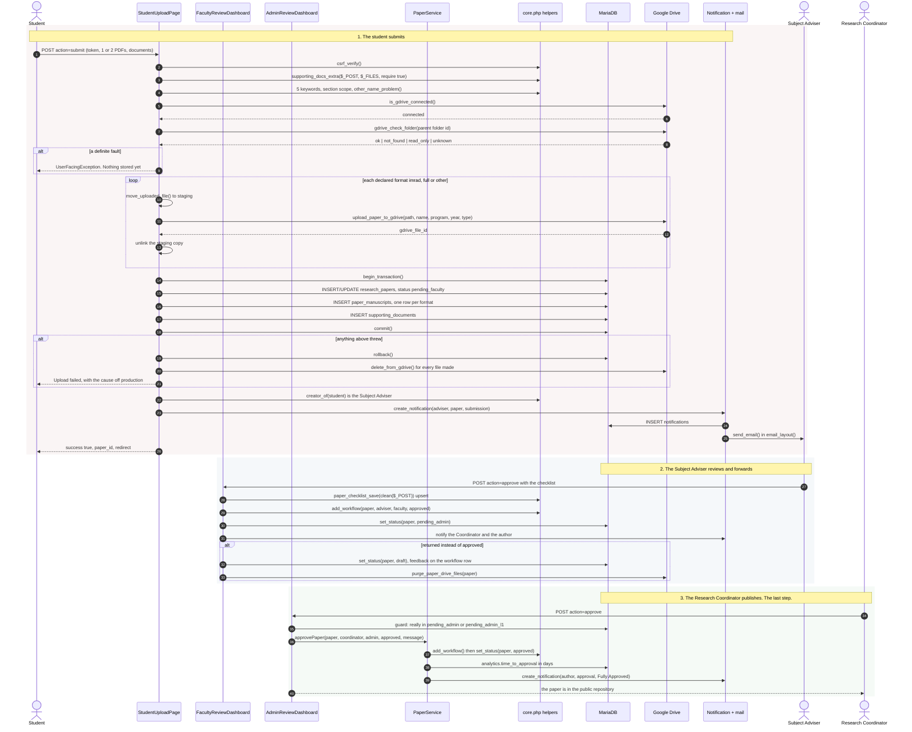
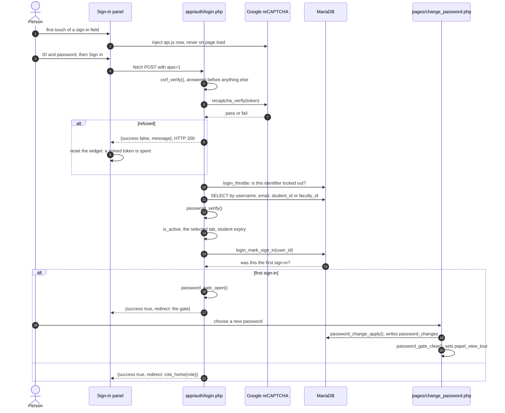
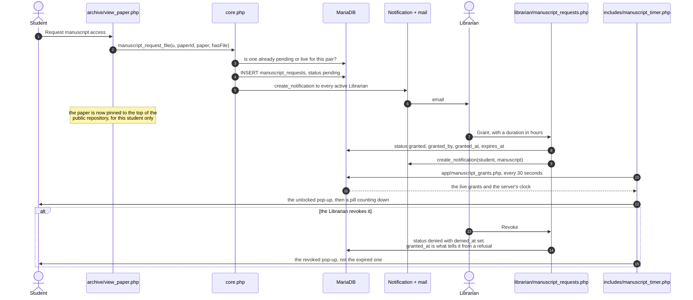
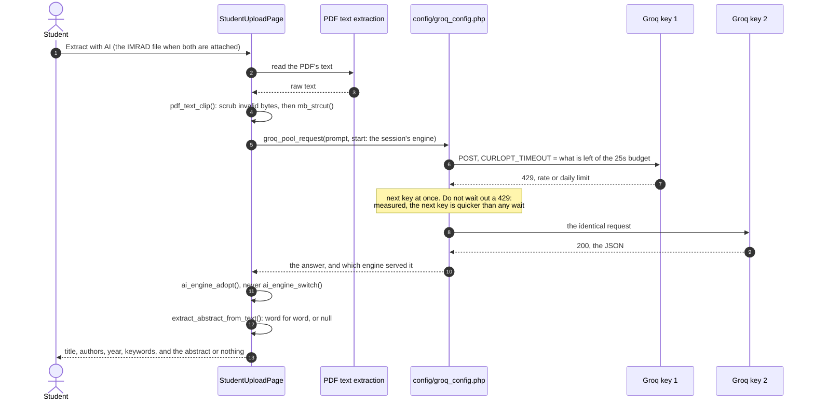

# PAPEL: Sequence Diagrams

**Kind:** current. Every message is a real call, read from the handler.
**Editable drawing:** [`papel_sequence_submission.drawio.svg`](papel_sequence_submission.drawio.svg)
(the main flow, sequence 1 below)
**Generated:** 15 November 2026.

---

## How to use this file

Hand the whole file to Claude Co-Work with one of these:

> Draw sequence 1 from the specification below as a draw.io-editable SVG.
> Keep the message order exactly: the order is the design.

> Draw sequences 2, 3 and 4 below as three more draw.io-editable SVGs, in the
> same notation as `papel_sequence_submission.drawio.svg`.

Only sequence 1 is drawn so far. Sequences 2 to 4 are specified here with
Mermaid source and have no SVG yet.

---

## Notation

- Solid line with a filled arrowhead: a synchronous call.
- Dashed line with an open arrowhead: a return.
- A bar on a lifeline: that participant is active.
- `alt` frame: a branch the handler really takes. `loop`: a real loop.
- Messages are numbered, because the order is the point.

---

# Sequence 1: a paper from Submit to published

This is the flow that touches most of the system. **Its order is the design**,
and three orderings in it were each the fix for a real failure:

1. **Drive is asked about before anything is stored.** A copy of the site has
   its own database and its own Drive token, written once by hand, and nothing
   sets either up on deploy. Staging was connected and still refused every
   paper, because the folder named in `system_settings.gdrive_parent_folder_id`
   lived in a Google account the connected one could not see. Drive answered
   `404` on the last step, after the PDF had been moved, and the student read
   "Upload failed."
2. **Every file is on Drive before the transaction opens.** Submitting is
   all-or-nothing: if any part fails, the transaction rolls back and the Drive
   files and staging copies that request made are deleted.
3. **Nothing after the commit may report a failure.** The paper is filed by
   then. The tail sits in a `try` of its own; a failure there is logged against
   a reference and the student is still told their paper was submitted. It used
   to answer "Upload failed" for a paper that was in fact filed, which invites
   filing it twice.

## Participants

| # | Lifeline | What it is |
|---|---|---|
| 1 | Student | actor |
| 2 | StudentUploadPage | `app/student/student_upload_ai.php` |
| 3 | FacultyReviewDashboard | `app/faculty/faculty_review_dashboard.php` |
| 4 | AdminReviewDashboard | `app/admin/admin_review_dashboard.php` |
| 5 | PaperService | `app/models/PaperService.php` |
| 6 | core.php helpers | `config/core.php` |
| 7 | MariaDB | through mysqli, one connection from `db()` |
| 8 | Google Drive | `config/gdrive_config.php` |
| 9 | Notification + mail | `create_notification()` and `send_email()` |
| 10 | Subject Adviser | actor |
| 11 | Research Coordinator | actor |

## Messages

### Phase 1: the student submits

| # | From | To | Message |
|---|---|---|---|
| 1 | Student | UploadPage | `POST action=submit`: CSRF token, 1 or 2 manuscript PDFs, supporting documents |
| 2 | UploadPage | core | `csrf_verify()` |
| 3 | UploadPage | core | `supporting_docs_extra($_POST, $_FILES, require: true)` |
| 4 | UploadPage | core | at least 5 keywords, the section scope, `other_name_problem()` |
| 5 | UploadPage | Drive | `is_gdrive_connected()` |
| 6 | Drive | UploadPage | *return* connected |
| 7 | UploadPage | Drive | `gdrive_check_folder(parent folder id)` |
| 8 | Drive | UploadPage | *return* `ok` / `unset` / `not_found` / `not_folder` / `trashed` / `read_only` / `unknown` |

**alt [a definite fault]**

| # | From | To | Message |
|---|---|---|---|
| 9 | UploadPage | Student | *return* `UserFacingException` in words. Nothing has been stored yet |

`unknown` is **not** a verdict: it means Drive could not be asked, and the
submission goes on. Only the four definite faults stop it
(`gdrive_folder_is_unusable()`).

**loop [for each declared format: imrad, full, or other]**

| # | From | To | Message |
|---|---|---|---|
| 10 | UploadPage | *self* | `move_uploaded_file()` into the staging folder |
| 11 | UploadPage | Drive | `upload_paper_to_gdrive(path, name, program, year, type)` |
| 12 | Drive | UploadPage | *return* `gdrive_file_id` |
| 13 | UploadPage | *self* | unlink the staging copy: Drive holds the paper now |

**end loop**

| # | From | To | Message |
|---|---|---|---|
| 14 | UploadPage | MariaDB | `begin_transaction()` |
| 15 | UploadPage | MariaDB | `INSERT` or `UPDATE research_papers`, `current_status = 'pending_faculty'` |
| 16 | UploadPage | MariaDB | `INSERT paper_manuscripts`, one row per format, and the mirror columns |
| 17 | UploadPage | MariaDB | `INSERT supporting_documents`: the four named rows and the student's own |
| 18 | UploadPage | MariaDB | `commit()` |

**alt [anything above threw]**

| # | From | To | Message |
|---|---|---|---|
| 19 | UploadPage | MariaDB | `rollback()` |
| 20 | UploadPage | Drive | `delete_from_gdrive()` for every file this request made |
| 21 | UploadPage | Student | *return* "Upload failed", with the cause attached off production |

**end alt. From here nothing may report a failure.**

| # | From | To | Message |
|---|---|---|---|
| 22 | UploadPage | core | `creator_of(student)`: the Subject Adviser who made the account |
| 23 | UploadPage | Notify | `create_notification(adviser, paper, 'submission', ...)` |
| 24 | Notify | MariaDB | `INSERT notifications` |
| 25 | Notify | Subject Adviser | `send_email()` wrapped in `email_layout()` |
| 26 | UploadPage | Student | *return* `{ success: true, paper_id, redirect }` |

If `creator_of()` returns nothing, the paper reaches no review queue at all.
That is logged rather than passed over in silence.

### Phase 2: the Subject Adviser reviews and forwards

| # | From | To | Message |
|---|---|---|---|
| 27 | Subject Adviser | FacultyDesk | `POST action=approve`, with the review checklist |
| 28 | FacultyDesk | core | `paper_checklist_save(paper_id, paper_checklist_clean($_POST))`, an **upsert** |
| 29 | FacultyDesk | core | `add_workflow(paper, adviser, 'faculty', 'approved', feedback)` |
| 30 | FacultyDesk | MariaDB | `set_status(paper, 'pending_admin')` |
| 31 | FacultyDesk | Notify | `create_notification(Coordinator, 'submission')` and the author, `'approval'` |

**alt [returned instead of approved]**

| # | From | To | Message |
|---|---|---|---|
| 32 | FacultyDesk | MariaDB | `set_status(paper, 'draft')`; the feedback stays on the workflow row |
| 33 | FacultyDesk | Drive | `purge_paper_drive_files(paper)`: both files go, so the student attaches them again |

The checklist save is an upsert because a paper the Coordinator returned and the
adviser approved again would otherwise fail on the row it already has. It was a
plain `INSERT` against `unique_paper`, silent on PHP 8.0 and fatal on 8.1+.

### Phase 3: the Research Coordinator publishes

| # | From | To | Message |
|---|---|---|---|
| 34 | Research Coordinator | AdminDesk | `POST action=approve` |
| 35 | AdminDesk | MariaDB | guard: the paper really is in `pending_admin` or `pending_admin_l1` |
| 36 | AdminDesk | PaperService | `approvePaper(paper, coordinator, 'admin', 'approved', message)` |
| 37 | PaperService | core | `add_workflow(...)` then `set_status(paper, 'approved')` |
| 38 | PaperService | MariaDB | `analytics.time_to_approval`: `upload_date` to now, in days |
| 39 | PaperService | Notify | `create_notification(author, 'approval', 'Fully Approved')` |
| 40 | AdminDesk | Research Coordinator | *return* the paper is in the public repository |

`time_to_approval` is stamped **only** when `targetStatus === 'approved'`: an
adviser signing off is a step along the way, not the end of it.

## Mermaid source



---

# Sequence 2: signing in, and the first-sign-in password gate

**Not drawn yet.** `app/auth/login.php`, and `pages/change_password.php`.

**The order of the checks is the security.** reCAPTCHA and the lockout are
tested **before the password is looked at**, so the JSON endpoint cannot be used
to try credentials either.



Three things that are easy to get wrong here, all of them already bugs once:

- **A stale CSRF token is answered before `csrf_verify()` runs.** That function
  refuses with a redirect, which a fetch follows and reads as a page of HTML.
- **A solved reCAPTCHA is spent.** Google refuses the same token twice, so the
  widget is reset after every refusal.
- **A refusal is HTTP 200, not 401.** What failed is the sign-in, not the
  request.

---

# Sequence 3: a student asks for a manuscript, and a Librarian answers

**Not drawn yet.** `config/core.php` (`manuscript_request_file()`),
`app/librarian/manuscript_requests.php`, `includes/manuscript_timer.php`.



**There is no `revoked` status on purpose.** A new ENUM value is a migration
every copy of the site has to run before this code can deploy at all, and an
ENUM value the database does not know is stored as an empty string in silence.
Ask `manuscript_request_state()`, which answers `pending`, `granted`, `expired`,
`denied` or `revoked` from the columns.

**The server decides, twice.** The page holds a deadline and counts it down, but
it confirms with the server before it announces an expiry: the two clocks agree
to within about a second, and reaching zero is a question, not a verdict.

---

# Sequence 4: Extract with AI

**Not drawn yet.** `app/student/student_upload_ai.php` (`action=extract_ai`),
`config/groq_config.php`.



Four rules this sequence exists to record:

- **Cut text with `pdf_text_clip()`, never `substr()`.** `substr()` counts
  bytes, so it splits an "n with a tilde" or a peso sign, the whole string
  becomes invalid UTF-8, and `json_encode()` returns **false**: the request goes
  out with no body and the student reads "The AI could not identify the
  details". This affected one paper in sixteen on file.
- **What moves the call to the next key**: 429, 401, 403, 5xx. What stops it:
  400, 404, anything else, and a connection error. Four keys asked the same bad
  question is four keys wasted.
- **One call has a 25 second budget** (`GROQ_CHAIN_BUDGET`), because free
  hosting cuts a request off at about 30 seconds and answers with its own page,
  which carries no JSON.
- **A wrong abstract is worse than none.** `extract_abstract_from_text()`
  returns the abstract word for word or null, and null means the Abstract box
  keeps whatever the student typed.

---

## Checking a sequence against the code

Read the handler top to bottom and compare the order, not only the calls. The
three orderings at the top of sequence 1 all look like details and each one was
a real failure in production or on staging.

```bash
sed -n '760,1250p' app/student/student_upload_ai.php   # phase 1
sed -n '30,120p'   app/faculty/faculty_review_dashboard.php  # phase 2
sed -n '30,80p'    app/admin/admin_review_dashboard.php      # phase 3
cat app/models/PaperService.php
```
