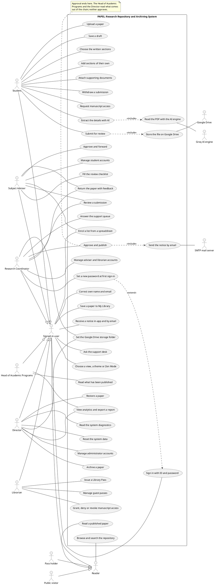

# PAPEL: Use Case Diagram

**Kind:** current. Describes who may do what, as the role checks enforce it.
**Editable drawing:** [`papel_use_case.drawio.svg`](papel_use_case.drawio.svg)
**Generated:** 15 November 2026.

---

## How to use this file

Hand the whole file to Claude Co-Work with one of these:

> Draw the PAPEL use case diagram from the specification below. Keep every
> actor, every use case and every association exactly as listed. Output
> draw.io-editable SVG.

> Check `docs/diagrams/papel_use_case.drawio.svg` against the specification
> below and list every disagreement.

The specification is the authority on what is in the diagram. The code is the
authority over it: `require_role()` at the top of each page, the `$RC` blocks in
the four review dashboards, and `can_manage_research_operations()` in
`config/core.php`. Where they disagree, the code wins.

---

## 1. The one rule the diagram exists to make unmistakable

**Approval ends at the Research Coordinator.**

```
Student uploads  ->  Subject Adviser  ->  Research Coordinator  ->  Published
                        (faculty)          (admin, level 1)
```

The Head of Academic Programs and the Director *read* what comes out of the
chain. Neither approves. This chain was deliberately shortened, and six
documents that told the reader to add a fourth and fifth stage were deleted in
November 2026 for saying otherwise. Do not draw an approval association from the
Head or the Director.

Two more facts of the same kind:

- **A paper a member of staff uploads is published at once**, with no review.
  `student_upload_ai.php` files it as `approved` if the uploader is not a
  student.
- **Returning a paper sets it back to `draft`.** So `draft` means either "never
  submitted" or "returned", and only the `approval_workflow` rows tell them
  apart.

## 2. Actors

### Human actors, and the role shape behind each

| Actor | `users.user_role` | Home page |
|---|---|---|
| Student | `student` | `app/student/student_dashboard.php` |
| Subject Adviser | `faculty` | `app/faculty/faculty_review_dashboard.php` |
| Research Coordinator | `admin` **at `admin_level = 1`** | `app/admin/admin_review_dashboard.php` |
| Head of Academic Programs | `head_academic`, **or** `admin` at `admin_level = 2` | `app/faculty/head_review_dashboard.php` |
| Director | `super_admin` | `app/admin/super_admin_review_dashboard.php` |
| Librarian | `librarian` | `app/librarian/librarian_manage_guests.php` |
| Pass holder | a `guest_sessions` row, **no `users` row** | `archive/index.php` |
| Public visitor | not signed in | `archive/index.php` |

**Two role shapes do the Head of Academic Programs job.** A role check that
covers `head_academic` and misses `admin` at level 2 (or the other way round)
is a bug, and has been one. Ask `config/core.php`, never a bare role string:
`is_research_coordinator()`, `can_manage_research_operations()`,
`user_has_role()`, `user_level_for()`.

**One person may hold two posts.** The account keeps one `user_role`; the second
post is a position name in `users.secondary_position`. So a Librarian who also
holds the Research Coordinator post gets both lanes. The diagram shows this as a
note, not as a ninth actor.

### Abstract actors (generalisation parents)

| Actor | Generalised from | For |
|---|---|---|
| Signed-in user | all six roles | sign in, the password gate, own details, My Library, notices, the view and theme settings, the support desk |
| Reader | Signed-in user, Pass holder, Public visitor | browse and search the repository, read a published paper |

Draw these with hollow-triangle generalisation arrows. Without them the diagram
needs about fifty extra association lines saying the same thing.

### External system actors

| Actor | Reached through |
|---|---|
| Google Drive | `config/gdrive_config.php`. Every manuscript and supporting document lives there, not on the web server |
| Groq AI engine | `config/groq_config.php`. A pool of keys, tried in order |
| SMTP mail server | `send_email()` in `config/core.php`, through PHPMailer |

## 3. Use cases

### Shared, by any signed-in account

| # | Use case | Notes |
|---|---|---|
| S1 | Sign in with ID and password | ID matches `username`, `email`, `student_id` **or** `faculty_id`. reCAPTCHA and the lockout are tested before the password |
| S2 | Set a new password at first sign-in | A gate: nothing else on the site opens until it is done |
| S3 | Correct own name and email | **Staff only.** A student is told it is the adviser's to do |
| S4 | Browse and search the repository | Reader |
| S5 | Read a published paper | Reader. Signed out, the paper's page asks for a sign-in |
| S6 | Save a paper to My Library | Not a Pass holder: a pass has no `users` row for the row to belong to |
| S7 | Receive a notice in-app and by email | Every `create_notification()` does both |
| S8 | Ask the support desk | Writes `support_requests` |
| S9 | Choose a view, a theme or Zen Mode | Cards, Rows, Hardbounds, Bookshelf; the palette; Zen Mode |

### Student

| # | Use case | Notes |
|---|---|---|
| ST1 | Upload a paper | Step 1 to 4 of `student_upload_ai.php` |
| ST2 | Save a draft | **A draft holds no PDF**, on this server or on Drive |
| ST3 | Choose the written sections | Which of the six sections are submitted; stored in `imrad_content._scope` |
| ST4 | Add sections of their own | Up to 12, stored in `imrad_content._custom` |
| ST5 | Attach supporting documents | Four named rows plus as many as the student names |
| ST6 | Withdraw a submission | 24 hours while it is with the adviser; see `submission_cancel_state()` |
| ST7 | Request manuscript access | Goes to every active Librarian |
| ST8 | Extract the details with AI | Fills title, authors, year, keywords, and the abstract word for word or not at all |
| ST9 | Submit for review | Sets `pending_faculty` and tells the adviser |

### Subject Adviser

| # | Use case | Notes |
|---|---|---|
| A1 | Review a submission | Only papers from students whose accounts this adviser created |
| A2 | Fill the review checklist | **Only the adviser edits it, and only on Approve** |
| A3 | Approve and forward | Sets `pending_admin`, tells the Coordinator and the author |
| A4 | Return the paper with feedback | Sets `draft`, and **purges both Drive files** |
| A5 | Manage student accounts | Create, edit, reset a password, deactivate |
| A6 | Enrol a list from a spreadsheet | CSV or `.xlsx` of ID, Name, Email |

An adviser may also upload a paper of their own, which is published at once.

### Research Coordinator

| # | Use case | Notes |
|---|---|---|
| C1 | Approve and publish | **The last step.** Sets `approved` and stamps `time_to_approval` |
| C2 | Review a submission | The same use case as A1, with no scope filter |
| C3 | Return the paper with feedback | The same use case as A4 |
| C4 | Manage adviser and librarian accounts | One console creates both |
| C5 | Enrol a list from a spreadsheet | The same use case as A6 |
| C6 | Set the Google Drive storage folder | Shared with the Director since 14 November 2026 |
| C7 | Answer the support queue | Sees the whole queue, not only rows routed to them |

### Head of Academic Programs

| # | Use case | Notes |
|---|---|---|
| H1 | Read what has been published | Read only. No approval |
| H2 | View analytics and export a report | Shared with the Director |

### Director

| # | Use case | Notes |
|---|---|---|
| D1 | Manage administrator accounts | **Not shared with the Coordinator**, who could otherwise mint a second Coordinator |
| D2 | Archive a paper | Out of the public repository, into `papers_archive` |
| D3 | Restore a paper | Back again |
| D4 | Set the Google Drive storage folder | Shared with the Coordinator |
| D5 | View analytics and export a report | Shared with the Head |
| D6 | Read the system diagnostics | `app/student/upload_diagnostics.php`, staff only |
| D7 | Reset the system data | **Not shared.** Empties the system |

### Librarian

| # | Use case | Notes |
|---|---|---|
| L1 | Grant, deny or revoke manuscript access | Revoke is written as `denied` with `denied_at` set, which `granted_at` tells from a refusal |
| L2 | Issue a Library Pass | A `guest_sessions` row, emailed |
| L3 | Manage guest passes | List, delete, clean up expired ones |

### What the system does for itself

Drawn in a row of their own, each with its external actor underneath.

| # | Use case | Pulled in by |
|---|---|---|
| X1 | Store the file on Google Drive | ST9, `<<include>>` |
| X2 | Read the PDF with the AI engine | ST8, `<<include>>` |
| X3 | Send the notice by email | C1 and every other `create_notification()`, `<<include>>` |

## 4. Relationships between use cases

| From | Kind | To |
|---|---|---|
| Submit for review | `<<include>>` | Store the file on Google Drive |
| Extract the details with AI | `<<include>>` | Read the PDF with the AI engine |
| Approve and publish | `<<include>>` | Send the notice by email |
| Set a new password at first sign-in | `<<extend>>` | Sign in with ID and password |

The extend is the right way round: signing in is complete on its own, and the
gate only happens on a first sign-in.

## 5. Layout rules that keep it readable

The drawing uses lanes, not a cloud of ovals.

1. One column of ovals per actor, with the actor above it.
2. A shared column on the left, with the two abstract actors beside it.
3. The three system use cases in a row along the foot, each with its external
   actor directly beneath it.
4. **Every association runs along one horizontal bus under the actor row and
   then down the target lane's own trunk.** An actor reaching into another
   actor's lane therefore shares that lane's trunk rather than cutting across
   the ovals in between. This is what lets 35 use cases and 59 associations fit
   with no line crossing an oval.
5. Generalisation arrows share a bus down the far left margin.

## 6. PlantUML source

Mermaid has no use case diagram, so this is PlantUML. Paste into any PlantUML
renderer.



## 7. Checking the drawing against the code

For each actor, open the pages it is drawn against and read the first three
lines:

```bash
grep -rn "require_role(" app/ pages/ analytics/ archive/ | sort
```

Then check the four review desks' `$RC` blocks, which are where each desk's
tabs, its scope and whether it can approve at all are configured:

- `app/faculty/faculty_review_dashboard.php` (`'review' => 'faculty'`, checklist on)
- `app/admin/admin_review_dashboard.php` (`'review' => 'admin'`, checklist off)
- `app/faculty/head_review_dashboard.php` (no approval)
- `app/admin/super_admin_review_dashboard.php` (`'review' => null`, read only)

A use case drawn against an actor whose page does not let that role in is the
one kind of error in this diagram that matters, because somebody will build to
it.
